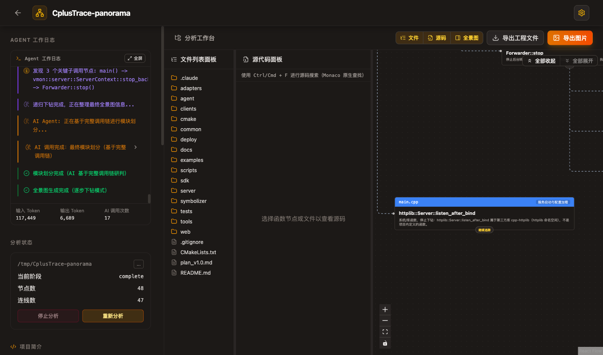

# Code Panorama 项目全景分析

> 日期：2026-11-02
> 工具：[code-panorama](https://github.com/xuanyuanzhifeng/code-panorama)
> 模型：OpenAI 兼容接口（DeepSeek `deepseek-chat`），最大下钻深度 2、单函数子调用 5
> 分析对象：本项目源码的过滤副本（排除 `third_party/`、`build/`、`.git/` 等）
> 原始导出：[panorama-export.md](code-panorama/panorama-export.md)



## 1. 运行方式与结果

```bash
# 1) 生成便于分析的源码副本（避免三方源码淹没调用图）
rsync -a --exclude 'third_party/' --exclude 'build/' --exclude '.git/' \
  /Users/tshua/respo/Code/CplusTrace/ /tmp/CplusTrace-panorama/

# 2) 启动 code-panorama
cd /tmp/code-panorama
npm install
# .env 中配置 LLM_BASE_URL / LLM_MODEL / LLM_API_KEY（Key 不进入本项目 git）
npm run dev

# 3) 浏览器打开 http://localhost:3000
#    选择「本地目录」→ 输入 /tmp/CplusTrace-panorama → 生成全景图
```

本次结果：

- 扫描 184 个文件，其中代码文件 145 个；
- 识别语言：C++；
- 入口：`server/src/main.cpp`；
- 生成 48 个节点、47 条边、8 个模块；
- 18 次 AI 调用，输入约 11.9 万 token，输出约 6.8k token。

## 2. 工具识别出的入口与模块

入口候选：

```
server/src/main.cpp
agent/src/main.cpp
sdk/src/vmon.cpp
examples/hello/main.cpp
examples/http_backend/main.cpp
```

工具校验后选择 `server/src/main.cpp` 作为主入口。

8 个模块：

| 模块 | 工具归类的内容 |
|---|---|
| 服务启动与配置加载 | `main`、`load_server_config`、`listen_after_bind` |
| HTTP 路由注册与 Web 托管 | `register_routes`、`server.Post/Get/Delete/Options`、静态目录挂载 |
| 事件接入与处理管道 | `/v1/ingest` 中的 `pipeline.process`、`store.ingest`、`rules.on_event`、`forwarder.submit` |
| 查询与结果序列化 | `store.query_traces`、`query_logs`、`trace_detail_json`、`log_clusters` |
| 后台任务调度与生命周期 | `start_background`、`stop_background`、`background_loop`、线程 join |
| 事件外发转发器 | `Forwarder::start/run/stop/flush_once` |
| 告警通知器 | `Notifier::start/stop/run` |
| 存储维护与规则评估 | `RuleEngine::evaluate`、`Store::prune` |

## 3. 关键调用链解读

### 3.1 启动与关停

```
main
├─ load_server_config
├─ ServerContext(config)
├─ register_routes
│   ├─ server.Post / Get / Delete / Options
│   └─ set_mount_point（Web UI）
├─ start_background
│   ├─ Forwarder::start
│   ├─ Notifier::start
│   └─ background_loop（规则评估 + Store prune）
├─ server.listen_after_bind（独立线程）
└─ sigwait → server.stop → stop_background
    ├─ join background
    ├─ Notifier::stop
    └─ Forwarder::stop
```

**观察**：

- 启动顺序清晰：配置 → 路由 → 后台组件 → 监听 → 等信号；
- 关停顺序是「先停监听，再停后台」，避免新请求进入；
- 后台线程、通知线程、转发线程都有 `running_` 原子标志 + `join`；
- 但 `main.cpp` 同时承担参数解析、配置合并、信号屏蔽、路由注册和生命周期，
  属于典型的「入口函数过重」，后续可拆成 `bootstrap / config / signal / http_server`。

### 3.2 事件接入主路径

```
POST /v1/ingest
  → authorized（Token）
  → Pipeline::process（入库前脱敏）
  → Store::ingest（trace/log/metric/event 索引）
  → RuleEngine::on_event（告警/事件）
  → Forwarder::submit（可选外发）
```

**观察**：

- 数据流是单向的：接入 → 脱敏 → 存储 → 规则 → 转发；
- 脱敏在 Store 之前，符合「敏感数据不入库」；
- 规则评估在写入路径内同步执行，单条事件延迟会包含规则判断；
  规则多、日志风暴时需要关注背压（当前 Store 有界，规则有冷却）；
- Forwarder 是异步队列，不阻塞接入。

### 3.3 查询路径

```
GET /api/traces
  → authorized
  → Store::query_traces
  → trace_detail_json
      → analyze_trace（树/关键路径/首个错误）
      → error_chain / thread_timeline（本轮新增）
      → 关联日志
      → context（进程/节点/系统）
```

**观察**：

- 查询是只读路径，复用同一个 Store 锁；
- `trace_detail_json` 已经成为「多维聚合点」：树、错误链、线程、上下文、日志；
- 随着字段增加，建议把它拆成 `trace_detail`（纯数据）+ `trace_context`
  （进程/节点/指标）+ `trace_presenter`（JSON 组装）。

### 3.4 后台循环

```
background_loop
  → RuleEngine::evaluate
  → Store::prune
  → sleep 200ms（受 rule_interval_ms 控制评估频率）
```

**观察**：

- 规则评估与存储清理在同一线程，互不阻塞 HTTP；
- `Store::prune` 保证内存有界；
- 线程生命周期由 `ServerContext` 统一管理，代码结构清晰。

## 4. 工具给出的结构性问题（人工复核）

| 问题 | 位置 | 建议 |
|---|---|---|
| 入口函数过重 | `server/src/main.cpp` | 拆为 `bootstrap`（CLI/配置）、`http_server`（监听）、`lifecycle`（信号/停止） |
| 路由注册函数过大 | `server/src/api.cpp::register_routes` | 按域拆成 `register_ingest_routes`、`register_query_routes`、`register_control_routes`、`register_admin_routes` |
| 路由与业务逻辑耦合 | `register_routes` 内大量 lambda | 每个路由只做参数解析/鉴权，调用 `api::handlers` 中的普通函数，便于单测 |
| trace 详情聚合过重 | `trace_detail_json` | 拆成数据采集、分析、序列化三层；已有 `error_chain/thread_timeline` 可独立测试 |
| 多线程生命周期分散 | Forwarder / Notifier / ServerContext | 抽象一个 `BackgroundService` 基类（start/stop/join），统一日志与异常边界 |
| 工具误分类 | `std::thread`、`std::condition_variable` 被归入业务模块 | 这是 AI 分类误差，人工图里可忽略；不影响主链路结论 |

## 5. 对「立体排障」的验证

本轮新增的多维能力在工具图中也能看到：

- `trace_detail_json` 聚合了 `error_chain`、`thread_timeline`、`context`；
- `Store::query_traces` 支持 `error_code`，错误码视图从 `recent_traces` 聚合；
- `Diagnostics::diagnose` 输出 `error_chain / threads / remediation`；
- `dump_stacks` 通过 CommandStore 下发到 Agent/SDK，形成「Trace → 线程栈」闭环。

## 6. 局限与后续

1. 本次只分析了 **server 入口**（工具选择 `server/src/main.cpp`）；
   Agent、SDK、Web、Python 客户端应分别以 `agent/src/main.cpp`、
   `sdk/src/vmon.cpp`、`web/app.js`、`clients/python/vmon_trace.py` 为入口再跑一次；
2. 最大下钻深度 2，适合看主干，不适合完整函数级调用图；
   需要细节时单独对某个模块提高深度；
3. AI 自动模块划分有少量误差（标准库/三方库函数被归入业务模块），
   本报告已人工修正关键结论；
4. Code Panorama 需要 LLM Key，Key 只保存在本机 `/tmp/code-panorama/.env`，
   不进入本项目仓库。

## 7. 结论

Code Panorama 对当前项目的判断与我们的模块设计基本一致：

- 主入口是 `vmon-server`，启动/接入/查询/后台四条主链清晰；
- `Pipeline → Store → Rules → Forwarder` 是事件主路径；
- `register_routes` 和 `main.cpp` 是当前最值得拆分的两个大函数；
- 多维排障能力（错误链、线程、上下文、诊断建议）已经在 trace/diagnose
  路径上形成闭环。

后续重构优先做「拆 main / 拆 routes / 抽 BackgroundService」，
不会改变对外 API，但能显著降低复杂逻辑下的维护与定位成本。
