# 详细模块设计

> 日期：2026-11-01
> 面向：需要二次开发、排查问题或做代码评审的工程师。
> 关联：[plan_v1.0.md](../plan_v1.0.md)、[feature-gap-design.md](feature-gap-design.md)、
> [production-safety.md](production-safety.md)。

## 1. 背景、需求与使用示例

### 1.1 背景

目标系统是一套局域网内的 C++ 多进程系统：

- 10–50 个节点、50–200 个进程；
- 进程间以 gRPC/HTTP2 为主，少量 Socket；
- 一次用户请求可能跨 5 跳以上，且会调用其他局域网进程；
- 纯内网、可离线，不能依赖外部 SaaS 或云存储；
- 现场排障现状：每个进程各自打日志，监控/控制/业务/错误日志混在一起；
  出错时只打错误日志，缺少请求上下文；开发人员要在多机、多文件之间人工对齐时间线。

模块设计要回答四个问题：

1. **在哪里采**：业务进程、节点、中心各负责什么；
2. **怎么串**：一次请求如何跨进程、跨线程关联；
3. **怎么控**：日志量大、内存有限、中心可能停机时如何降级；
4. **怎么不影响业务**：探针、采集、分析都不能改变原业务行为。

### 1.2 需求分解

| 编号 | 需求 | 模块落点 | 验收方式 |
|---|---|---|---|
| R1 | 统一采集日志/指标/Span/崩溃 | `sdk/` + `common/json_event.h` | E2E 中四类事件均可入库 |
| R2 | 跨进程、跨线程还原调用链 | `adapters/` + `server/trace_builder` | 跨进程父子 Span、拓扑边 |
| R3 | 日志降噪但保留错误 | `server/store` + `log_cluster` | 采样/去重/聚类计数可查 |
| R4 | 崩溃可捕获、可符号化 | `sdk/crash` + `agent/crash_collect` + `server/crash` | E2E SIGSEGV 捕获 |
| R5 | 指标、SLO、事件闭环 | `agent/metrics` + `server/slo` + `rules` | SLO/事件 E2E |
| R6 | 一键诊断、巡检、证据包 | `server/diagnostics` + `evidence` | 诊断结论 + 证据包校验和 |
| R7 | 不影响生产 | SDK fail-open、Agent 独立进程、白名单命令 | 单测 + 生产约束文档 |
| R8 | 离线、可移植 | 无外部存储依赖，C++14 | 本机构建 + Linux 兼容检查 |
| R9 | Python/Web 客户端接入 | `clients/` + `examples/http_backend` | E2E Python RPC 同一 trace |
| R10 | 可扩展 | 采集器/规则/存储/通知扩展点 | 新增模块不改主流程 |

非功能约束：

| 指标 | 目标 |
|---|---|
| SDK 业务线程开销 | CPU < 1%，常驻 < 15 MB |
| 单次 Span 创建 | < 100 ns（目标值） |
| 事件队列 | 每线程 512 条，满则丢弃计数 |
| WAL | 默认单段 4 MB、总上限 64 MB |
| Store | trace 2 万、日志 20 万、指标 10 万、事件 5000 |
| 部署 | 单机可跑，纯内网，无 Node/外网依赖 |

### 1.3 设计目标与约束

| 目标 | 约束 |
|---|---|
| 不影响业务 | SDK 热路径不分配、不加锁、不做 IO；所有失败 fail-open |
| 局域网离线 | 不依赖外部存储、云服务、Node 运行时；中心单机可跑 |
| 有界资源 | 每线程事件环、WAL、Store、聚类、证据包都有上限 |
| 统一模型 | 日志/指标/Span/崩溃/事件共用一套 Event JSON |
| 可独立升级 | SDK、Agent、Server、Web、CLI、MCP 通过进程/接口解耦 |
| C++14 基线 | 不使用 C++17 特性，兼容 gcc 7.3 / aarch64 |

### 1.4 使用示例

#### 示例 1：本机启动并造一个跨语言场景

```bash
# 构建
cmake -S . -B build -DCMAKE_BUILD_TYPE=Debug
cmake --build build -j

# 方式 A：只起栈
./scripts/vmon.sh up
# Web UI: http://127.0.0.1:18428/  令牌: dev-token

# 方式 B：一条命令起栈 + 造场景 + 打印看点和 request_id
python3 examples/scenarios/demo.py --scenario rpc --keep
```

#### 示例 2：业务进程接入 SDK

```cpp
#include <vmon/vmon.h>

vmon::Config config;
config.service_name = "order-service";
config.instance_id = "order-1";
config.agent_endpoint = "/run/vmon/agent.sock";
vmon::init(config);

void Handle(const char* request_id) {
  vmon::set_request_id(request_id);   // 指针需活到事件发送
  {
    VMON_SPAN("Handle");
    VMON_INFO("handling request_id=%s", request_id);
    vmon::heartbeat();
  }
  vmon::set_request_id(nullptr);
}
```

CMake 一行接入：

```cmake
list(APPEND CMAKE_MODULE_PATH "/path/to/CplusTrace/cmake")
include(vmon)
vmon_attach(your_target)
```

#### 示例 3：Python / Web 客户端接入

Python：

```python
from vmon_trace import Client

client = Client("http://127.0.0.1:18428", "dev-token",
                service="py-bff", node="node-1")
with client.span("GET /orders", request_id="REQ-1") as span:
    status, body = client.request(
        "GET", "http://backend:9000/api/orders", request_id="REQ-1")
    span.set_attr("http.status_code", status)
client.close()
```

C++ 后端续接：

```cpp
vmon::SpanContext parent;
if (vmon::context_from_traceparent(header, &parent)) {
  vmon::Span span = vmon::create_span_with_parent(
      parent, "HTTP/Handle", __FILE__, __LINE__);
}
```

浏览器：

```js
const tracedFetch = vmonTrace.instrumentFetch(window.fetch, {
  service: "web-console",
  requestId: "REQ-1",
  report: (event) => navigator.sendBeacon("/bff/vmon/events",
                                          JSON.stringify(event))
});
```

#### 示例 4：排障时的固定查询

```bash
BASE=http://127.0.0.1:18428
TOKEN=dev-token

# 按业务请求号找 trace
curl -s -H "X-Vmon-Token: $TOKEN" "$BASE/api/requests/REQ-1"

# 只看错误 / 最慢
curl -s -H "X-Vmon-Token: $TOKEN" "$BASE/api/traces?error=1&min_duration_ns=500000000"

# 一键诊断
curl -s -H "X-Vmon-Token: $TOKEN" -H 'Content-Type: application/json' \
  -d '{"request_id":"REQ-1"}' "$BASE/api/diagnose"

# 生成证据包
curl -s -H "X-Vmon-Token: $TOKEN" -H 'Content-Type: application/json' \
  -d '{"incident":"INC-001","request_id":"REQ-1"}' "$BASE/api/evidence"
```

CLI：

```bash
./build/tools/vmonctl --server "$BASE" --token "$TOKEN" \
  traces --request REQ-1 --error
./build/tools/vmonctl --server "$BASE" --token "$TOKEN" \
  diagnose --request REQ-1
```

更多场景见 [scenario-cookbook.md](scenario-cookbook.md)，快速定位方法见
[quick-diagnosis.md](quick-diagnosis.md)。

## 2. 目录与模块总览

```
sdk/            业务进程内的探针（静态库 libvmon.a）
adapters/       traceparent / Socket 头的传播适配
agent/          节点常驻采集代理（vmon_agent）
server/         中心服务（vmon_server）
common/         事件模型、SHA-256 等公共代码
symbolizer/     addr2line / llvm-symbolizer 封装
tools/          vmonctl、vmon_mcp、vmon_crash_helper
web/            静态 Web UI（无构建、无 CDN）
clients/python  Python trace 客户端
clients/web     浏览器 trace 客户端
examples/       hello、http_backend、scenarios
tests/          单测与 E2E
```

### 2.1 模块依赖

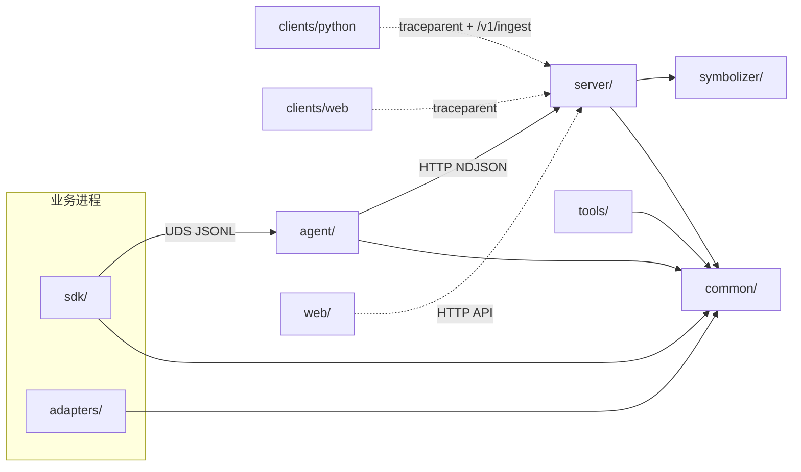

## 3. SDK（`sdk/` + `adapters/`）

### 3.1 子模块

| 模块 | 关键文件 | 职责 | 线程/开销 |
|---|---|---|---|
| 环形队列 | `sdk/src/core/ring_buffer.h` | 每线程 SPSC 无锁队列，容量 512（可用 511） | 业务线程 push，满则丢弃计数 |
| 线程上下文 | `sdk/src/core/thread_context.h` | 事件环、Span 栈（深度 32）、request/task ID | 线程本地，首次使用时创建 |
| 线程注册表 | `sdk/src/core/registry.*` | 后台线程遍历所有线程上下文 | 注册/注销非热路径 |
| 时钟与 ID | `sdk/src/core/clock.h`、`ids.h` | 双时间戳、128 位 trace / 64 位 span | 无锁、xorshift |
| Span | `sdk/src/trace/span.cpp` | RAII Span、父子关系、错误码、采样抑制 | 创建 < 100ns 目标 |
| 日志 | `sdk/src/log/log.cpp` | 分级日志、格式化、截断、上下文注入 | 热路径不分配 |
| 发送线程 | `sdk/src/transport/sender.*` | 排空各线程环，序列化 JSONL，写 UDS | 100ms / 64KB 批量 |
| 控制通道 | `sdk/src/control/control_server.*` | `set_level`、`ping`、`dump_stacks`、`get_stats` | 独立线程，UDS |
| 崩溃兜底 | `sdk/src/crash/crash_handler.*` | async-signal-safe 写最小崩溃 JSON | 信号上下文，只 write |
| 传播编解码 | `adapters/grpc/propagation.*` | W3C traceparent、request_id/task_id 头 | 无状态函数 |
| Socket 头 | `adapters/ipc/socket_header.h` | 24 字节 trace 头编解码 | 无状态函数 |

### 3.2 公共 API

`vmon::init/shutdown/enabled`、`heartbeat`、`set_request_id/task_id`、
`current_context`、`create_span_with_parent`、`Span::create/set_error/end`、
`VMON_SPAN`、`VMON_INFO/WARN/ERROR`、`context_from_traceparent`。

### 3.3 一次日志/Span 的路径

```
业务线程:
  VMON_INFO/VMON_SPAN
    -> 读取线程本地 request_id/task_id + 当前 Span
    -> 组装 POD Event（名称/文件/行号均为静态字符串）
    -> RingBuffer::push（满则 dropped++，不阻塞）

后台 sender:
  for_each_thread_context -> pop 事件
    -> 序列化为 JSONL（非法 UTF-8 用 replace，绝不抛异常）
    -> write(UDS)
    -> 失败则计数，Agent 恢复后继续
```

### 3.4 失败与边界

- SDK 未初始化、Agent 不在线、队列满：业务无感知，只累计 dropped；
- `Span::create` 超过深度上限：返回空 span，不分配、不报错；
- 同一槽位复用的 Span 会清空 `error_code`，避免错误“传染”；
- `request_id/task_id` 只保存指针，必须活到事件发送（默认 100ms），
  示例与后端使用字符串字面量或有界 ID 池；
- 崩溃处理器默认关闭，开启后只写预打开 fd 并 `_exit`。

## 4. Agent（`agent/`）

### 4.1 子模块

| 模块 | 关键文件 | 职责 |
|---|---|---|
| 配置/工具 | `agent/src/agent.*` | 配置、主机名、URL 拆分、目录 |
| UDS 接入 | `agent/src/ingest.*` | 单线程 poll，多个 SDK 客户端，按行回调 |
| 本地 WAL | `agent/src/wal.*` | 分段追加、封存、容量上限、恢复读取 |
| 上传 | `agent/src/uploader.*` | 批量 HTTP 上报，失败保留段文件重试 |
| 进程/主机扫描 | `agent/src/process_scan.*` | `/proc` 解析（macOS 走 `ps` 兜底） |
| 主机指标 | `agent/src/metrics.*` | `host.*` 与可选 `process.rss_bytes` 事件 |
| 文件日志 | `agent/src/log_tail.*` | inode + 偏移跟踪，轮转重开，只读完整行 |
| 控制客户端 | `agent/src/control_client.*` | 连接 `<control_dir>/<pid>.sock` |
| 命令执行 | `agent/src/command_runner.*` | 轮询 Server 命令，白名单只读执行，回报 |
| 崩溃收集 | `agent/src/crash_collect.*` | 扫描 `crash-<pid>.json`，上传后删除 |
| 主循环 | `agent/src/main.cpp` | 组装上述模块、定时器、信号处理 |

### 4.2 WAL 与上传

```
ingest 收到一行 -> wal.append(line)
  -> 当前段累计 >= wal_segment_bytes 或超过 1s 且有数据 -> 封存
  -> uploader 每 upload_interval_ms 读取封存段
      -> POST /v1/ingest（NDJSON + token）
      -> 成功删除段；失败保留，下一轮重试
  -> 总容量超过 wal_max_bytes -> 删除最旧段（优先保错误/崩溃）
```

### 4.3 命令流

```
Server 命令队列
  <- Agent 每 command_interval_ms 轮询 /api/commands
  -> command_runner 按类型执行
      ping / set_log_level / dump_stacks / get_stats / diagnose
  -> control_client 连接业务进程控制 socket
  -> 结果 POST /api/commands/{id}/result
```

### 4.4 定时器

| 定时器 | 默认 | 作用 |
|---|---|---|
| 进程/主机扫描 | 2s | 进程快照、`host.*` 指标 |
| 日志 tail | 500ms | 读取新增完整行 |
| 命令轮询 | 100ms~1s | 下发控制/诊断命令 |
| 上传 | 200ms~1s | WAL 封存段上传 |
| 崩溃扫描 | 2s | 崩溃报告上传 |

## 5. Server（`server/`）

### 5.1 子模块

| 模块 | 关键文件 | 职责 |
|---|---|---|
| 配置/启动 | `server/src/config.*`、`main.cpp` | 参数、状态目录、Web 根目录 |
| HTTP API | `server/src/api.cpp` | 鉴权、查询、控制、证据包、MCP |
| 存储 | `server/src/store.*` | 有界 trace/log/metric/event，索引与治理 |
| 资产目录 | `server/src/catalog.*` | 节点 → 进程 → 服务实例，存活判断 |
| 链路还原 | `server/src/trace_builder.*` | Span 树、关键路径、首个错误、拓扑边 |
| 日志聚类 | `server/src/log_cluster.*` | 模板归一化、指纹、关键字段提取 |
| 规则引擎 | `server/src/rules.*` | 心跳/错误日志/错误率/慢调用/指标 |
| SLO | `server/src/slo.*` | 定义校验、持久化、SLI/预算/燃烧率 |
| 诊断/巡检 | `server/src/diagnostics.*` | 只读检查项、假设与结论 |
| 证据包 | `server/src/evidence.*` | 裁剪、脱敏、SHA-256 清单 |
| 剖析 | `server/src/profiler.*` | 折叠栈聚合、Top self/inclusive、火焰图 |
| 崩溃 | `server/src/crash.*` | 崩溃去重、指纹、符号化入口 |
| 命令队列 | `server/src/commands.*` | 下发、状态、结果、超时 |
| 转发 | `server/src/forwarder.*` | 可选 VM/VL 转发（默认关闭） |
| 序列化 | `server/src/serialize.*` | Trace/Log/Cluster JSON |

### 5.2 接入与查询

```
Agent POST /v1/ingest
  -> 鉴权
  -> 逐行 parse -> Event
  -> Store::ingest
       span_begin/end -> TraceData + 索引
       log -> 采样/去重/噪声 -> 聚类 -> 索引
       metric -> MetricPoint
       crash/host/process -> CrashStore/Catalog
  -> RuleEngine::on_event -> 事件中心
  -> Forwarder（可选）

GET /api/traces/{id}
  -> Store::get_trace
  -> analyze_trace：树、关键路径、首个错误、最慢 Span
  -> 关联日志 -> JSON
```

### 5.3 有界资源

| 资源 | 默认上限 |
|---|---|
| trace | 20000 条 |
| 日志 | 200000 条（每 key 5000） |
| 指标 | 100000 点 |
| 事件 | 5000 条 |
| 日志聚类 | 5000 个 |
| SLO | 200 个 |
| 证据包 | 按窗口裁剪，目标 < 50MB |

## 6. 公共与外围模块

| 模块 | 职责 |
|---|---|
| `common/json_event.h` | Event 结构与 JSON 编解码，SDK/Agent/Server 共用 |
| `common/sha256.*` | 证据包文件校验和 |
| `symbolizer/` | `addr2line` / `llvm-symbolizer`，build-id 索引 |
| `tools/cli/` | `vmonctl` 子命令 |
| `tools/mcp/` | stdio MCP 桥，只读工具 |
| `tools/crash_helper/` | core_pattern helper |
| `web/` | hash 路由 SPA，14 个视图 |
| `clients/python/` | Python Span、HTTP 包装、批量上报 |
| `clients/web/` | 浏览器 traceparent 注入、fetch 包装 |
| `examples/http_backend/` | 接收 Python/Web 调用并续接 trace 的 C++ 后端 |
| `examples/scenarios/` | 常用场景一条命令演示 |

## 7. 关键数据结构与协议

### 7.1 Event（统一事件）

```json
{
  "type": "span_begin|span_end|log|metric|host|process|crash|profile|event",
  "time_ns": 1793540000123000000,
  "mono_ns": 123456789,
  "trace": "32hex", "span": "16hex", "parent": "16hex",
  "service": "order", "instance": "order-1", "node": "node-07",
  "version": "v2.3.1", "pid": 4242, "tid": 123,
  "name": "HTTP/Handle", "file": "main.cpp", "line": 42,
  "level": "info", "msg": "...",
  "request_id": "REQ-1", "task_id": "TASK-1",
  "error_code": "E_DB", "attrs": {"k": "v"}
}
```

### 7.2 进程间接口

| 接口 | 方向 | 协议 | 用途 |
|---|---|---|---|
| `<uds>` | SDK → Agent | JSONL over UDS | 事件上报 |
| `<control_dir>/<pid>.sock` | Agent → SDK | 单行 JSON | 控制命令 |
| `<crash_dir>/crash-<pid>.json` | SDK → Agent | 文件 | 崩溃报告 |
| `POST /v1/ingest` | Agent/Python → Server | NDJSON + token | 事件接入 |
| `POST /v1/crash` | Agent → Server | JSON | 崩溃上报 |
| `POST /v1/profile` | Agent → Server | 折叠栈 | 剖析上报 |
| `GET /api/*` | Web/CLI/MCP → Server | JSON | 只读查询 |
| `POST /mcp` / stdio | MCP 客户端 → Server | JSON-RPC | 内部只读工具 |

### 7.3 关联键

- `trace_id + span_id + parent_span_id`：调用链；
- `request_id / task_id`：业务与调度；
- `node + pid + start_time`：进程身份（避免 PID 复用）；
- `build_id + version`：崩溃、符号化、发布变更；
- `fingerprint`：日志模板 + 级别 + 服务 + 错误码。

## 8. 运行时线程与背压

| 进程 | 线程/定时器 | 说明 |
|---|---|---|
| 业务进程 | 业务线程 | 只写 ring，不阻塞 |
| 业务进程 | sender 线程 | 100ms / 64KB，UDS 写失败计数 |
| 业务进程 | control 线程 | 接收动态级别/栈/命令 |
| Agent | ingest 线程 | poll 多个 SDK 连接 |
| Agent | 主循环 | 扫描/日志/命令/上传定时器 |
| Agent | uploader | 批量 HTTP，失败重试 |
| Server | HTTP 线程池 | 4 线程（`CPPHTTPLIB_THREAD_POOL_COUNT`） |
| Server | 规则评估 | 在写入路径内同步评估，带冷却 |
| Server | 查询 | 只读，统一 Store 锁 |

背压顺序：**ring 满 → 丢弃 + 计数**；**WAL 满 → 删最旧段**；
**Store 满 → 淘汰最旧**；**中心停机 → Agent 本地缓存 + 恢复补传**。

## 9. 扩展点

| 想加什么 | 落点 | 方式 |
|---|---|---|
| 新采集器（GPU、JVM、fd） | `agent/src/` | 定时采集 → `wal.append(to_json(event))` |
| 新规则类型 | `server/src/rules.*` | 在 `on_event` 分支增加判定 |
| 新通知渠道 | `server/src/` | 消费事件中心，新增 `Notifier`（当前未实现） |
| 新存储后端 | `server/src/forwarder.*` | 增加转发目标，或替换 Store |
| 新 RPC 协议 | `adapters/` | 实现注入/提取，复用 SpanContext |
| 新分析视图 | `server/src/trace_builder.*` / `web/app.js` | 新增只读接口 + 视图 |
| 新客户端语言 | `clients/<lang>` | 生成 traceparent，调用 `/v1/ingest` |
| 前端事件聚合 | BFF/网关 | 接收 `clients/web` 的回调，统一鉴权转发 |

## 10. 测试映射

| 模块 | 测试 |
|---|---|
| SDK 环/上下文/Span/传播 | `tests/ring_buffer_test.cpp`、`span_test.cpp`、`propagation_test.cpp` |
| Server 存储/链路/聚类/规则/SLO/API | `server/tests/*` |
| Agent WAL/接入/扫描/命令/崩溃 | `agent/tests/*` |
| 端到端 | `tests/e2e/run_e2e.py`（17 类场景） |
| Python 客户端 | `clients/python/test_vmon_trace.py` |
| Web 客户端 | `clients/web/test_vmon_trace.js` |
| UI | Playwright MCP 回归（见 `ui-test-report.md`） |

## 12. 类图与序列图

> 说明：类图只画核心字段与关系，省略 getter/内部辅助函数；序列图按真实调用顺序，
> 标出了线程边界与失败路径。
>
> 所有图同时导出为 SVG（编辑器不支持 Mermaid 时可直接打开）：
> [模块依赖](diagrams/module-dependency.svg) ·
> [SDK 类图](diagrams/sdk-class.svg) ·
> [Agent 类图](diagrams/agent-class.svg) ·
> [Server 类图](diagrams/server-class.svg) ·
> [事件上报时序](diagrams/seq-event-flow.svg) ·
> [动态级别时序](diagrams/seq-log-level.svg) ·
> [崩溃时序](diagrams/seq-crash.svg) ·
> [客户端时序](diagrams/seq-client.svg) ·
> [诊断/证据包时序](diagrams/seq-diagnose.svg) ·
> [框架总图](diagrams/principle-overall.svg) ·
> [关联键](diagrams/principle-keys.svg) ·
> [链路还原](diagrams/principle-trace.svg) ·
> [背压](diagrams/principle-backpressure.svg)

### 12.1 SDK 核心类图

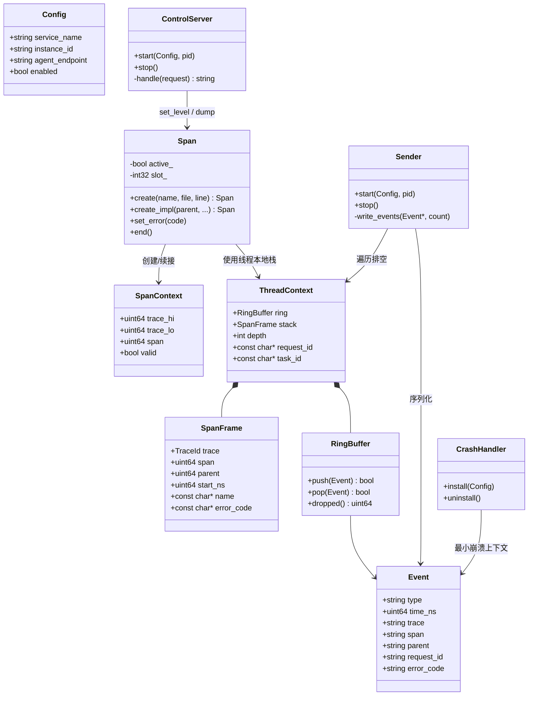

### 12.2 Agent 类图

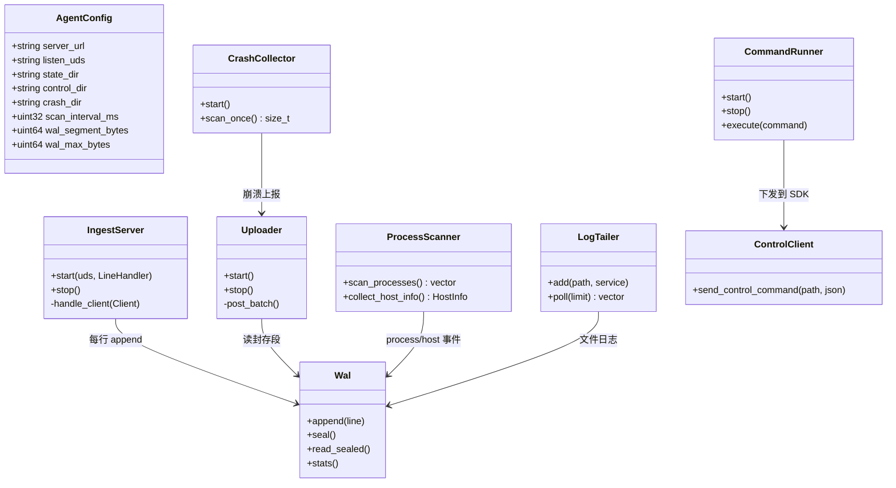

### 12.3 Server 数据模型类图

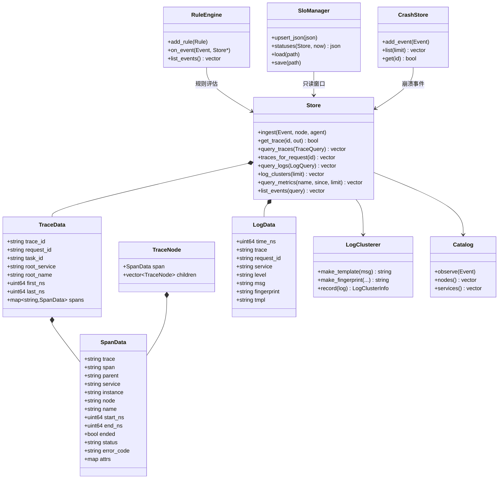

### 12.4 一次事件上报与查询（时序）

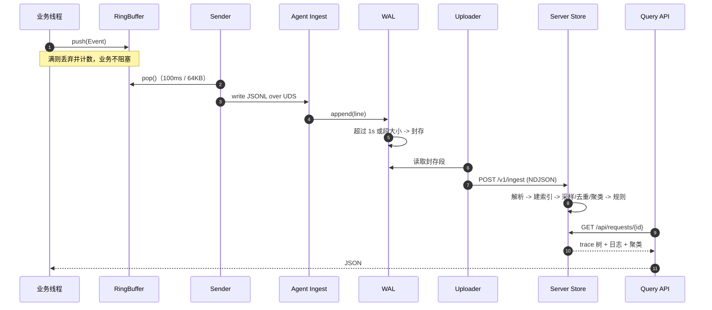

### 12.5 动态日志级别（时序）

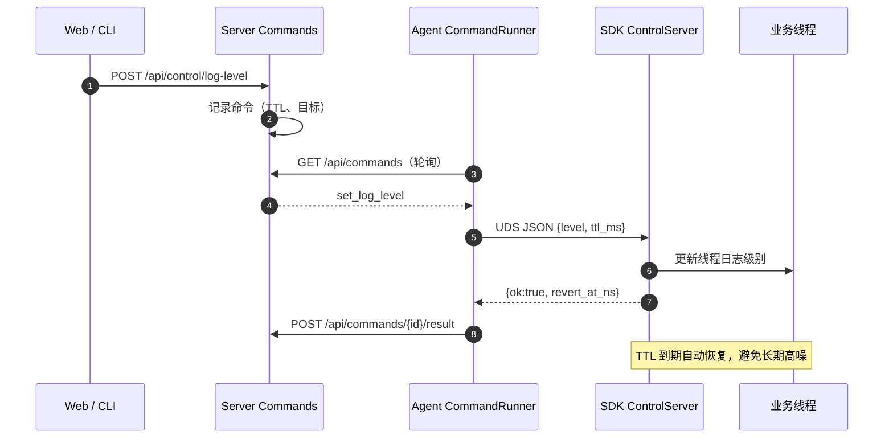

### 12.6 崩溃处理（时序）

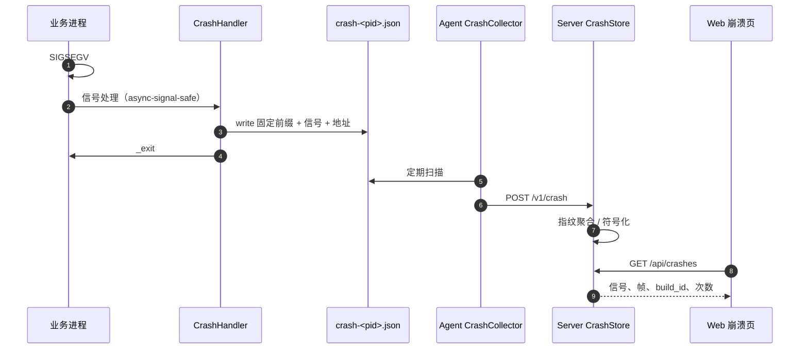

### 12.7 Python / Web 客户端调用（时序）

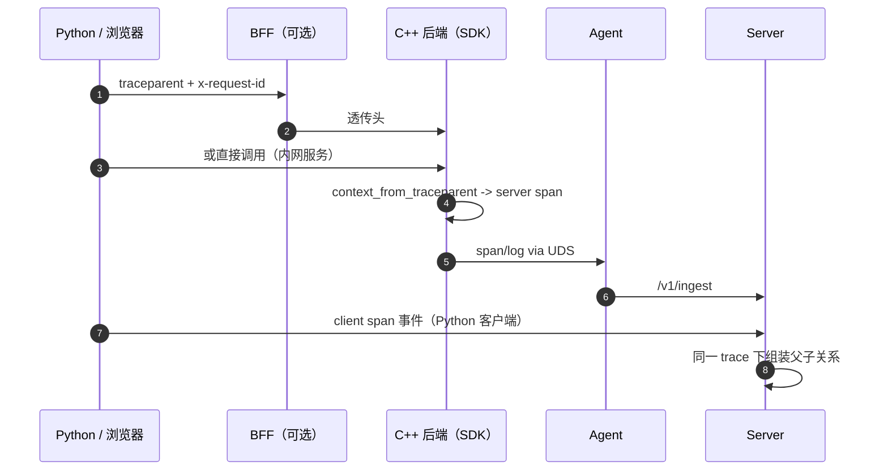

### 12.8 诊断与证据包（时序）

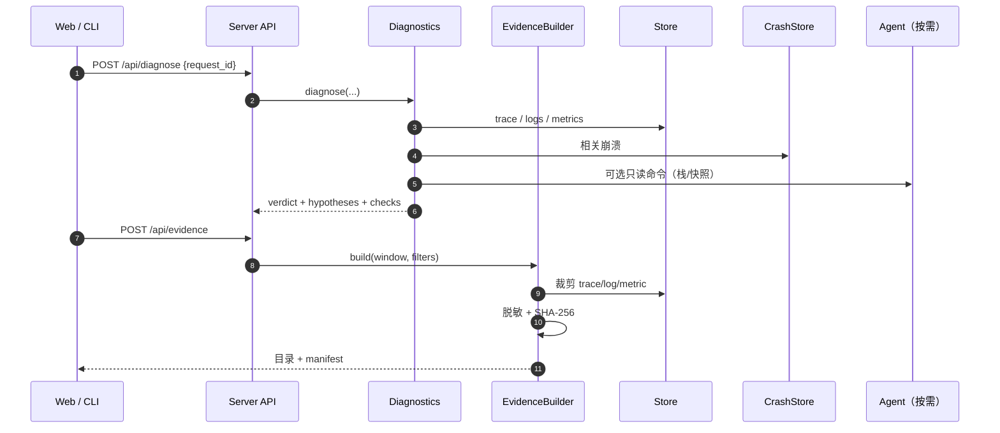

## 13. 框架原理图

### 13.1 总原理：所有信号收敛成一条事件流

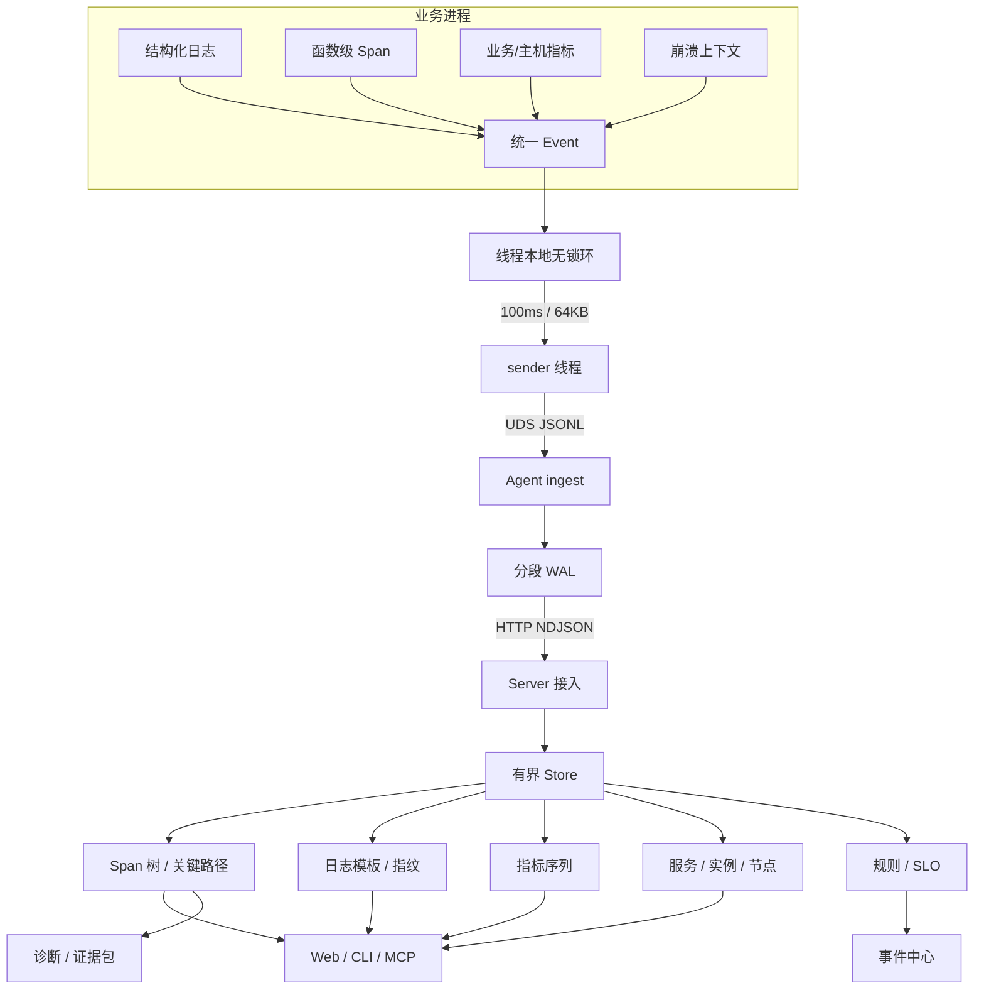

**原理**：不在每个进程里做关联，而是把「带统一关联键的事件」汇总到中心，
在中心做索引与分析。进程侧只负责轻量采集，因此可以独立升级、限流、关闭。

### 13.2 事件模型与关联键

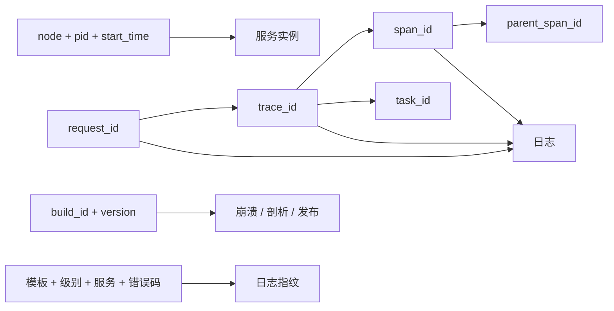

| 关联键 | 回答的问题 | 主要用途 |
|---|---|---|
| `trace_id / span_id / parent` | 谁调谁 | Span 树、关键路径、拓扑 |
| `request_id / task_id` | 业务是哪一单 | 请求级排障、日志收口 |
| `node + pid + start_time` | 哪个进程、哪次启动 | 进程身份、重启识别 |
| `build_id + version` | 对应哪次构建 | 崩溃符号化、发布关联 |
| `fingerprint` | 哪类日志 | 聚类、去重、告警 |

### 13.3 调用链还原原理

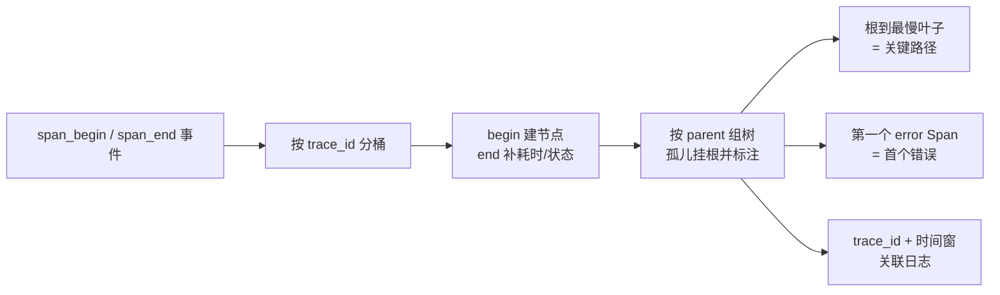

事件允许乱序到达：`span_end` 先到也能先记录耗时，树在 `begin` 到达后补齐；
查询时保证最终一致。

### 13.4 可靠性与背压原理

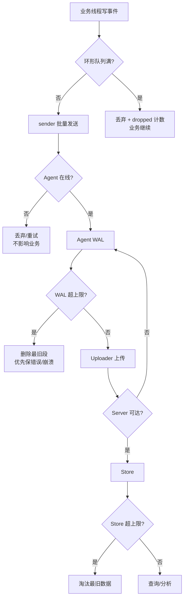

三条硬约束：

1. **不阻塞业务线程**：队列满只丢弃并计数；
2. **不把异常抛给业务**：SDK/发送/控制线程在边界吞掉异常；
3. **不在信号上下文做重活**：崩溃只写预打开 fd，然后退出。

## 14. 已知边界

1. 中心 Store 为内存有界存储，重启清空；长期存储通过 forwarder 接 VM/VL 或后续 Parquet。
2. gRPC 只提供传播层，client/server interceptor 需按目标工程版本接入；streaming/异步未覆盖。
3. Socket 只有 24 字节头编解码，具体协议接入由业务方完成；eBPF 弱边未实现。
4. 剖析只做折叠栈导入与聚合，不做常驻 `SIGPROF`/perf。
5. 通知渠道、BFF 聚合接口、OTLP 接入未实现。
6. Linux aarch64/gcc 7.3 需在目标机实机验证；macOS 为开发验证环境。
