# vmon 使用手册

> 面向第一次接触本系统的人：**从启动、看第一条链路，到定位错误、处理告警、导出证据**。
> 部署、权限、systemd、core_pattern 等运维细节见 [deployment.md](deployment.md)；
> 快速定位方法见 [quick-diagnosis.md](quick-diagnosis.md)；
> 更多场景见 [scenario-cookbook.md](scenario-cookbook.md) 与
> [examples/README.md](../examples/README.md)（含截图）。

## 1. 五分钟上手

前提：已按 [README](../README.md) 构建出 `build/`。

### 1.1 启动本地栈

```bash
./scripts/vmon.sh up        # 启动 Server + Agent
./scripts/vmon.sh status    # 进程、健康检查、UDS、日志路径
./scripts/vmon.sh logs agent -f
./scripts/vmon.sh down
```

`up` 会打印两个地址：

- 局域网：`http://<本机IP>:18428/`（其他机器可访问）；
- 本机：`http://127.0.0.1:18428/`。

默认监听 `0.0.0.0`，令牌 `dev-token`。**给局域网使用时务必改成强随机令牌**：

```bash
PORT=19428 VMON_TOKEN="$(openssl rand -hex 16)" VMON_HOME=/tmp/vmon \
  ./scripts/vmon.sh up
```

只允许本机访问时设置 `LISTEN_HOST=127.0.0.1`；服务器有防火墙时需放行
`PORT`（默认 18428）。

### 1.2 造一条真实请求

```bash
# 最小示例：两个请求，一个失败、一个成功
./examples/hello/run_demo.sh

# 常用场景：RPC / 慢调用 / 错误 / 日志风暴 / SLO / 崩溃
python3 examples/scenarios/demo.py --scenario all --keep
```

`--keep` 会保留栈，脚本打印 Web UI 地址、令牌、trace_id、request_id 和
CLI 命令；按 Ctrl+C 结束。

### 1.3 打开总览

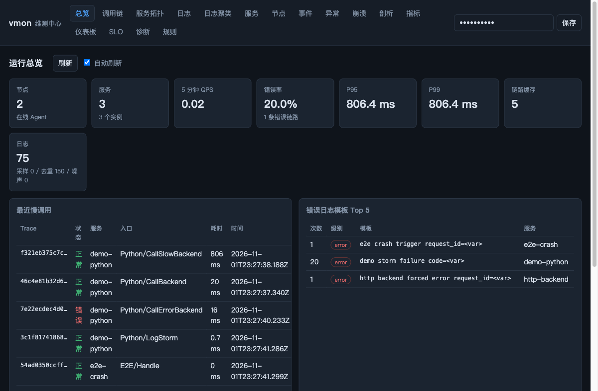

先看：节点、服务、QPS、错误率、P95/P99、最近慢调用、错误模板、可用性拨测。
有 `fail` 或错误率升高时，按下面场景进入。

## 2. 场景化教程

### 2.1 请求失败：从 request_id 到首个错误

**输入**：业务请求号、trace_id 或 task_id。

1. 打开「调用链」，搜索 `request_id` / `trace_id` / 服务名 / 错误码；
2. 勾选「仅错误」或填最小耗时收敛；
3. 打开一条 trace，看：

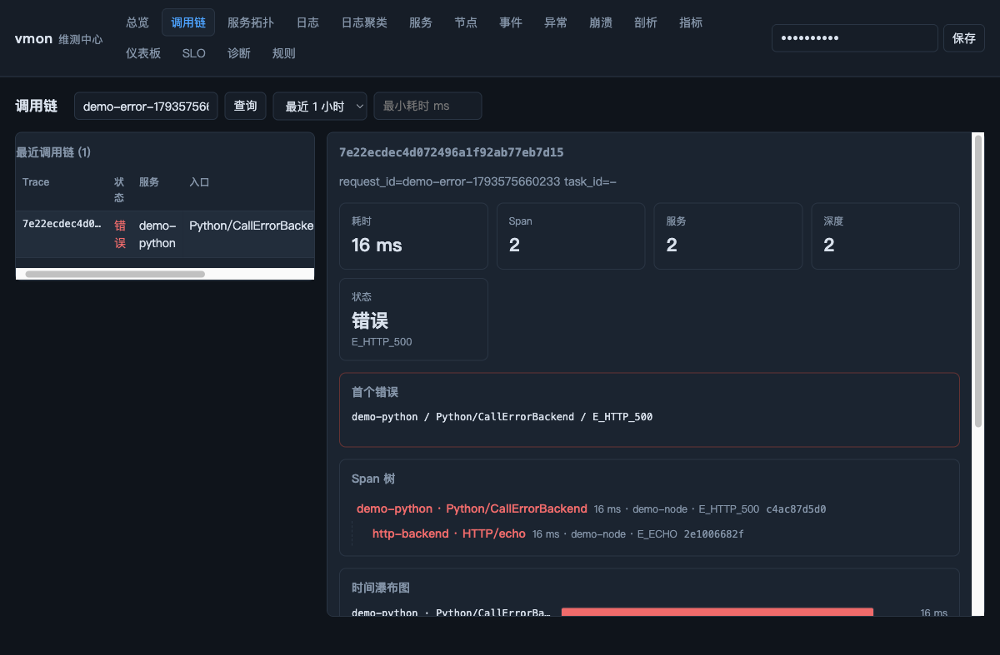

- **首个错误**：哪个服务、哪个 Span、错误码；
- **Span 树**：父子关系与跨进程跳转；
- **关键路径**：最慢的一条链路；
- **瀑布图**：每个阶段耗时；
- **关联日志**：不需要手工对齐时间。

4. 需要更多上下文时：「诊断」页填 request_id，执行诊断：

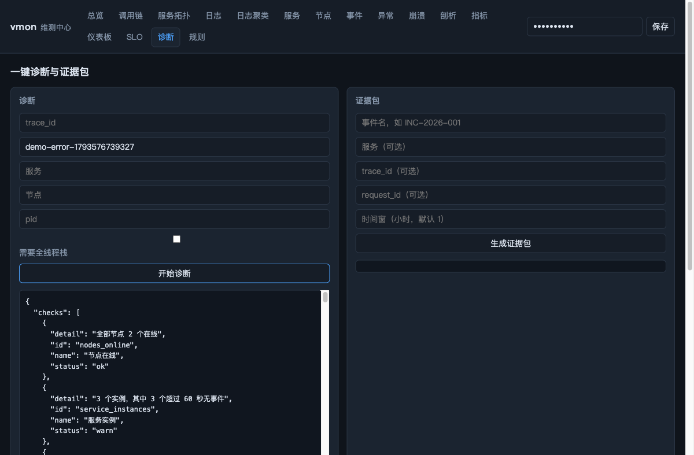

5. 需要复盘/交接时，生成证据包（脱敏 + SHA-256）。

```bash
BASE=http://127.0.0.1:18428; TOKEN=dev-token
curl -s -H "X-Vmon-Token: $TOKEN" "$BASE/api/requests/REQ-1"
curl -s -H "X-Vmon-Token: $TOKEN" -H 'Content-Type: application/json' \
  -d '{"request_id":"REQ-1"}' "$BASE/api/diagnose"
```

### 2.2 请求变慢：关键路径与火焰图

1. 「调用链」按服务 + 最小耗时过滤，打开最慢 trace；
2. 看 `slowest_span` 与关键路径；
3. 如果慢在本地代码，打开「剖析」→「火焰图」：

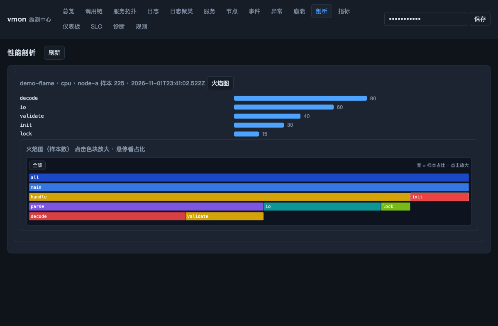

- 宽度 = 样本占比；点击色块放大，悬停看占比；「全部」返回；
- 需要常驻 CPU 采样时，用诊断版构建：
  `cmake -DVMON_ENABLE_CPU_PROFILER=ON`，业务侧 `enable_cpu_profiler=true`。

### 2.3 日志太多：检索与聚类

「日志」页支持 trace / request / task / 服务 / 节点 / 级别 / 文本 / 仅错误 /
时间窗：

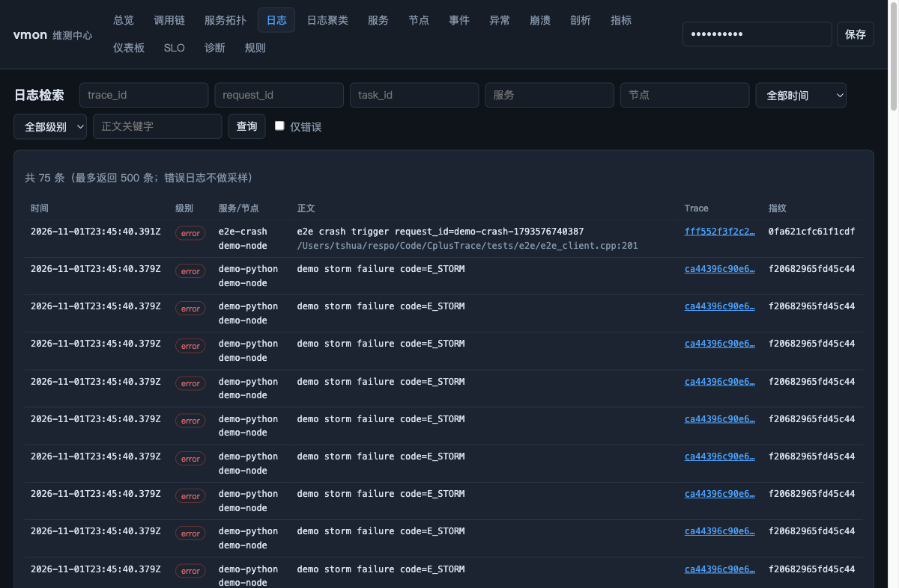

「日志聚类」按模板聚合（`<var>` 表示变化部分），先看次数最多和 error 模板，
再点指纹下钻：

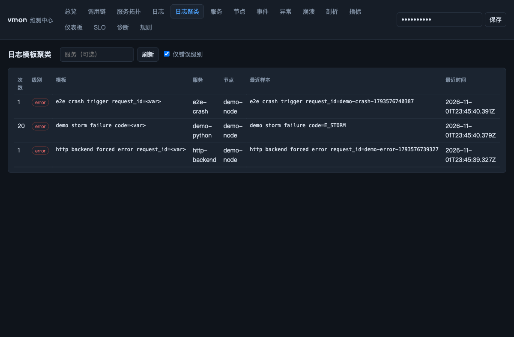

```bash
curl -s -H "X-Vmon-Token: $TOKEN" \
  "$BASE/api/logs?request_id=REQ-1&errors_only=1&limit=50"
curl -s -H "X-Vmon-Token: $TOKEN" "$BASE/api/logs/clusters?limit=20"
```

### 2.3.1 错误码横向定位：同一错误码跨多链路

复杂系统里同一个错误码往往出现在多条请求、多个服务上。不要只看一条 trace，
先看「错误码定位」：

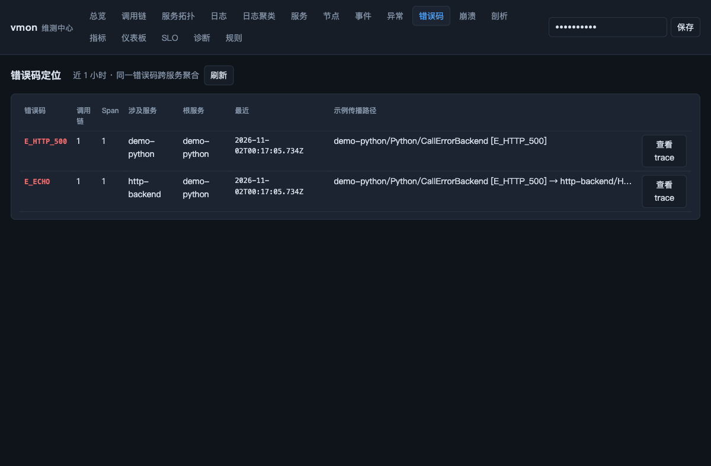

- 汇总同一错误码的调用链数、Span 数、涉及服务、根服务、首次/最近时间；
- 给出示例传播路径：`demo-python/Python/CallErrorBackend [E_HTTP_500] →
  http-backend/HTTP/echo [E_ECHO]`；
- 点击「查看 trace」直接回到完整时序链；
- API：

```bash
curl -s -H "X-Vmon-Token: $TOKEN" "$BASE/api/error-codes?limit=100"
curl -s -H "X-Vmon-Token: $TOKEN" "$BASE/api/traces?error_code=E_ECHO"
```

`q` 搜索也会匹配错误码，例如 `q=e_echo`。

### 2.4 重复错误：异常追踪 Issue

「异常」页把错误日志模板与崩溃指纹聚合成 Issue：

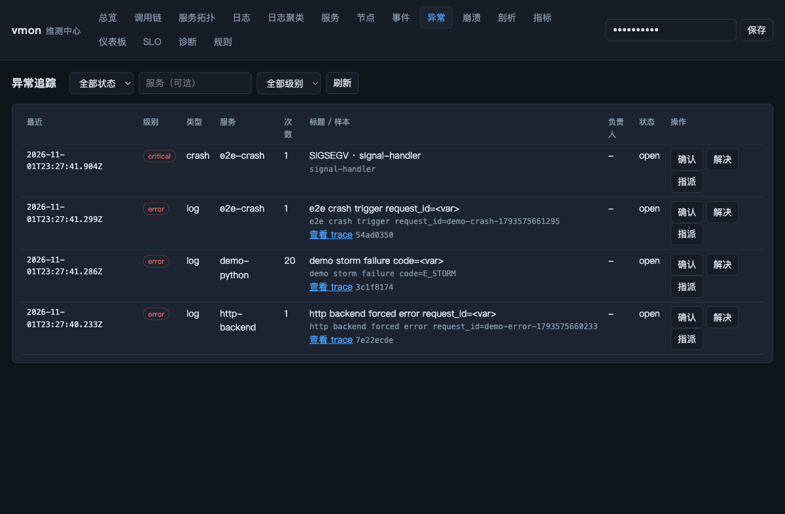

- 看次数、服务、样本、关联 trace；
- 「确认」→ 状态 ack；「指派」填负责人；「解决」→ resolved；
- API：

```bash
curl -s -H "X-Vmon-Token: $TOKEN" "$BASE/api/issues?status=open"
curl -s -H "X-Vmon-Token: $TOKEN" -H 'Content-Type: application/json' \
  -d '{"status":"ack","assignee":"alice","note":"排查中"}' \
  "$BASE/api/issues/<id>"
```

### 2.5 告警太吵：事件、静默与分组

「事件」页统一展示告警、崩溃、发布等事件：

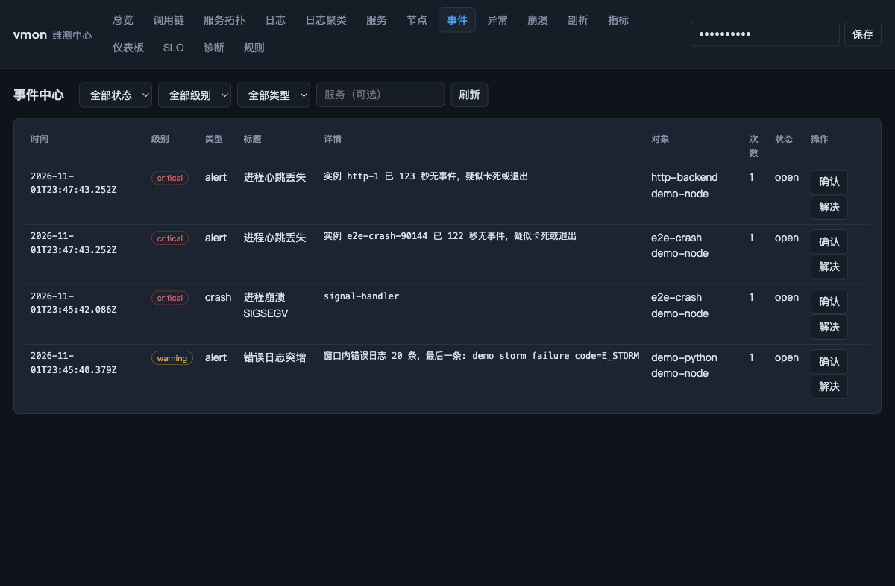

- 同指纹、未解决事件在 5 分钟窗口内合并，显示次数与最近时间；
- 发布/维护期间可在「规则 → 告警静默」创建静默：

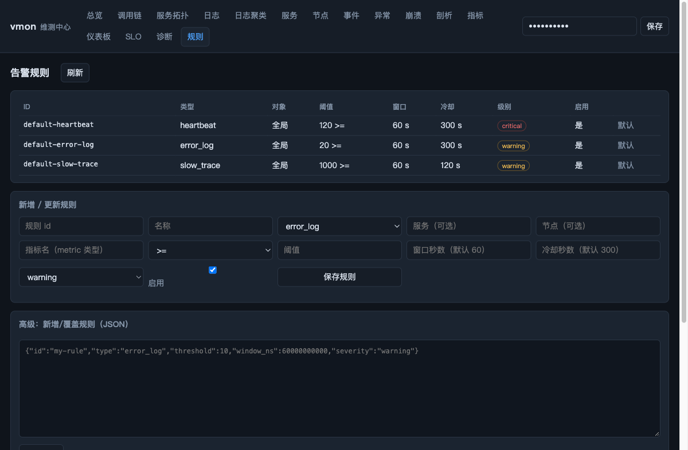

```bash
curl -s -H "X-Vmon-Token: $TOKEN" -H 'Content-Type: application/json' \
  -d '{"name":"发布窗口","service":"order","duration_minutes":30,"reason":"升级"}' \
  "$BASE/api/silences"
```

### 2.6 接口不可用：可用性拨测

Agent 增加 `--probe`，周期访问关键接口：

```bash
vmon_agent ... --probe \
  'order-api=http://127.0.0.1:9000/health;interval_ms=30000;timeout_ms=3000;status=200'
```

指标：`probe.up`、`probe.duration_ms`、`probe.status_code`；
总览「可用性拨测」显示 UP/DOWN，指标页可按名字查询，规则可基于 `probe.up` 配置。

```bash
curl -s -H "X-Vmon-Token: $TOKEN" "$BASE/api/probes"
```

### 2.7 影响面：服务拓扑

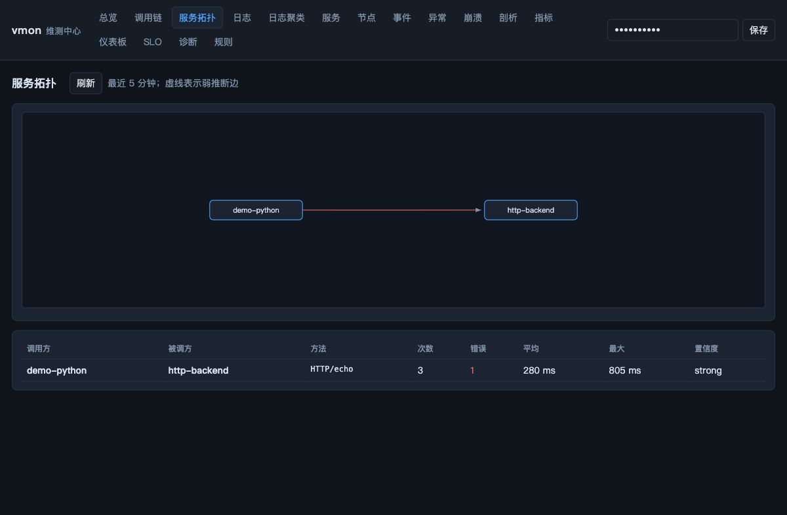

- 强边来自显式传播，进入 Span 树结论；
- 弱边带 `confidence`，只进拓扑，不污染调用链；
- 表格可看 caller/callee/method/count/error/avg/max。

### 2.8 目标与容量：SLO

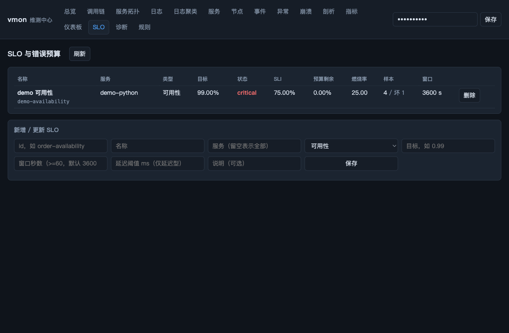

- 可用性型：窗口内无错误 trace 比例；
- 延迟型：窗口内耗时不超过阈值的比例；
- 看 SLI、错误预算剩余、燃烧率、状态（healthy/warning/critical/unknown）。

> SLO 基于中心内存窗口；重启后无数据会短暂 `unknown`。

### 2.9 复盘与交接：仪表板与快照

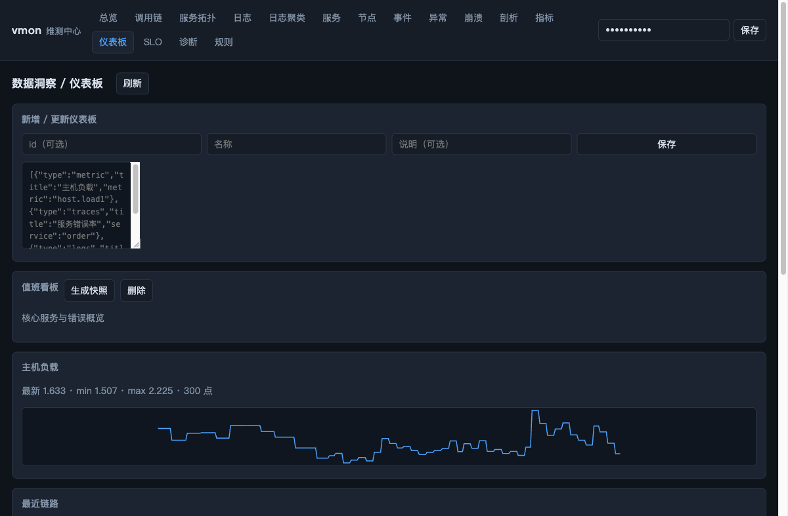

「仪表板」支持 metric / traces / logs / text widget；保存后即时计算。
「生成快照」保存只读数据，便于复盘或分享。

```bash
curl -s -H "X-Vmon-Token: $TOKEN" -H 'Content-Type: application/json' \
  -d '{"id":"dash-1","name":"值班看板","widgets":[
       {"type":"metric","title":"负载","metric":"host.load1"},
       {"type":"traces","title":"链路"},
       {"type":"logs","title":"错误模板","limit":5}]}' \
  "$BASE/api/dashboards"
curl -s -X POST -H "X-Vmon-Token: $TOKEN" \
  "$BASE/api/dashboards/dash-1/snapshot"
```

### 2.10 进程崩溃

「崩溃」页显示信号、次数、节点、原因、build_id、二进制、pid；有 debuginfo
时显示符号化栈，否则回退地址。崩溃同时进入事件中心，可被规则/Issue 聚合。

### 2.11 立体视图：线程 / 进程 / 系统

打开一条错误 trace，除了 Span 树和瀑布图，还能看到三层上下文：

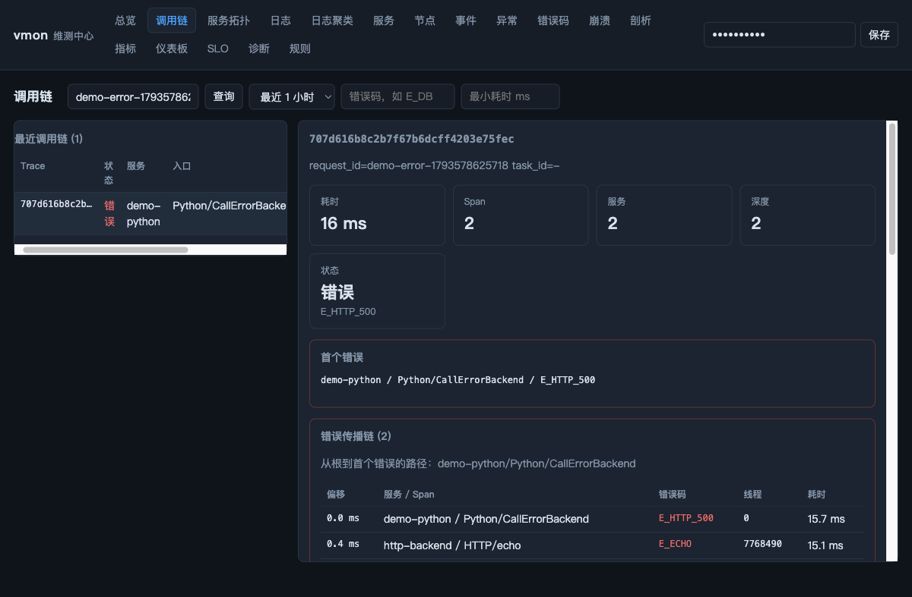

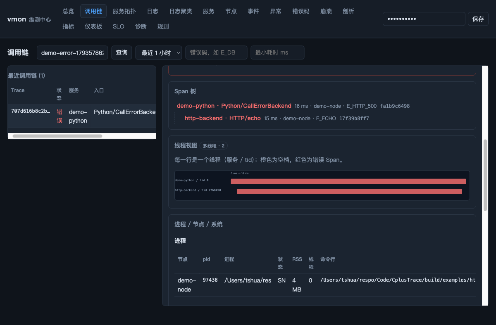

- **错误传播链**：所有错误 Span 按开始时间排序，显示偏移、服务/方法、错误码、
  线程与耗时；`first_path` 是从根到首个错误的完整路径。
- **线程视图**：按 `service/instance/node/tid` 分行，彩色条是 Span，红色是错误，
  橙色是超过 100ms 的空档；用于快速发现锁等待、IO 阻塞、线程池排队。
- **进程 / 节点 / 系统**：trace 涉及的 pid、命令行、状态、RSS、线程数；
  节点 OS/内核/架构/load/内存；trace 时间窗内的 `host.load1`、
  `host.mem_used_ratio`、`process.rss_bytes` 摘要。

> macOS 开发机通过 `ps` 兜底，进程线程数/内存字段可能不完整；Linux 目标机
> 使用 `/proc`，字段完整。

### 2.12 诊断建议与恢复动作

`POST /api/diagnose` 除了 `verdict / hypotheses / error_chain / threads`，还会返回
`remediation` 建议动作，例如：

```json
{"title":"抓取全线程栈","action":"command","risk":"low",
 "detail":"线程视图出现多线程或长空档时，抓取现场线程栈确认锁/IO/调度阻塞",
 "command":"POST /api/control/dump-stacks {node,pid}"}
```

设计原则：**只给可审计的观察/只读命令，不自动重启或修改业务数据**。
安全动作可以直接执行：

```bash
# 抓全线程栈（只读）
curl -s -H "X-Vmon-Token: $TOKEN" -H 'Content-Type: application/json'   -d '{"node":"node-a","pid":1234}' "$BASE/api/control/dump-stacks"

# 临时 debug 日志（带 TTL，到期自动恢复）
curl -s -H "X-Vmon-Token: $TOKEN" -H 'Content-Type: application/json'   -d '{"service":"order","level":"debug","ttl_ms":60000}'   "$BASE/api/control/log-level"
```

重启/回滚等有风险动作只作为建议，由人确认后在平台侧执行；证据包用于复盘。

## 3. 完整案例

> 下列 ID、耗时来自真实 demo 运行，**每次运行会变化**，以脚本打印/页面显示为准；
> 数值用于说明「应该看到什么」。先把脚本打印的地址设为变量：

```bash
BASE=http://127.0.0.1:<脚本打印的端口>
TOKEN=demo-token
```

> 所有带 `--keep` 的 demo 请在终端 A 保持运行，下面的 curl/查询在终端 B 执行；
> 按 Ctrl+C 结束 demo 后栈会清理。

| 案例 | 场景 | 关键视图 |
|---|---|---|
| 1 | 跨语言错误请求 | 调用链 + 日志 + 诊断 + 证据包 + 异常 |
| 2 | 慢调用 | 关键路径 + 瀑布图 + 火焰图 |
| 3 | 日志风暴 | 日志检索 + 模板聚类 + 采样/去重 |
| 4 | 接口不可用 | 可用性拨测 + 指标 |
| 5 | 进程崩溃 | 崩溃页 + 事件中心 |
| 6 | 复盘交接 | 仪表板 + 快照 |

### 案例 1：一次跨语言错误请求的完整排障

**场景**：Python 服务调用 C++ 后端，后端返回 500。

```bash
python3 examples/scenarios/demo.py --scenario error --keep
```

脚本打印的示例输入：

```
request_id = demo-error-1793575660233
trace_id   = 7e22ecdec4d072496a1f92ab77eb7d15
services   = demo-python, http-backend
duration   = 16.3 ms
```

**第 1 步：按 request_id 收口**

```bash
curl -s -H "X-Vmon-Token: demo-token" \
  "$BASE/api/requests/demo-error-1793575660233"
```

返回的 summary 应类似：

```json
{
  "span_count": 2,
  "service_count": 2,
  "depth": 2,
  "has_error": true,
  "error_code": "E_HTTP_500",
  "duration_ms": 16.3
}
```

**第 2 步：看 Span 树与首个错误**


示例 Span：

| 服务 | Span | 耗时 | 错误码 | 关系 |
|---|---|---|---|---|
| `demo-python` | `Python/CallErrorBackend` | 16.3 ms | `E_HTTP_500` | 根（client） |
| `http-backend` | `HTTP/echo` | 16.0 ms | `E_ECHO` | 子（server） |

解释：

- Python 侧把 HTTP 500 标记为 `E_HTTP_500`；
- C++ 后端在业务里 `set_error("E_ECHO")`；
- 两者在同一条 trace 中，`first_error` 通常是先结束的 client span，
  `slowest_span` 可用于确认耗时在服务端还是客户端。

**第 3 步：关联日志**

搜索同一个 request_id，示例日志：

```
error  http backend forced error request_id=demo-error-1793575660233
info   http backend handled request_id=demo-error-1793575660233
```

日志自动带 `trace_id`、`span_id`、`request_id`，不需要手工对齐。

**第 4 步：一键诊断**

```bash
curl -s -H "X-Vmon-Token: demo-token" -H 'Content-Type: application/json' \
  -d '{"request_id":"demo-error-1793575660233"}' \
  "$BASE/api/diagnose"
```

示例结论：

```json
{
  "verdict": "business_error",
  "first_error": {"service": "demo-python", "name": "Python/CallErrorBackend",
                  "error_code": "E_HTTP_500"},
  "hypotheses": [{"title": "业务错误码 E_HTTP_500"}],
  "checks": [{"id": "nodes_online", "status": "ok"}, ...]
}
```

**第 5 步：生成证据包**

```bash
curl -s -H "X-Vmon-Token: demo-token" -H 'Content-Type: application/json' \
  -d '{"incident":"INC-DEMO-001","request_id":"demo-error-1793575660233"}' \
  "$BASE/api/evidence"
```

示例返回：

```json
{
  "ok": true,
  "id": "239d0c2f75f1",
  "dir": "/tmp/.../evidence-INC-DEMO-001-...",
  "files": ["manifest.json", "timeline.json", "request.json",
            "metrics.json", "logs.jsonl", "profiles/", "dumps/",
            "index.jsonl", "hypotheses.md"]
}
```

先看 `request.json`（链路）和 `timeline.json`（告警/发布/崩溃时间线），
再按需查看日志与指标；`manifest.json` 带每个文件的 SHA-256 与脱敏规则。

**第 6 步：进入异常追踪**

「异常」页会出现类似：

```
级别   error
服务   http-backend
次数   1
标题   http backend forced error request_id=<var>
样本   http backend forced error request_id=demo-error-...
```


处理：

```bash
curl -s -H "X-Vmon-Token: demo-token" -H 'Content-Type: application/json' \
  -d '{"status":"ack","assignee":"alice","note":"排查中"}' \
  "$BASE/api/issues/<issue_id>"
```

### 案例 2：慢调用与火焰图

```bash
python3 examples/scenarios/demo.py --scenario slow --keep
```

示例输入：`demo-slow-1793543987304`，后端 sleep 800ms。

预期：

- `slowest_span` 为 Python 客户端 Span（约 809ms）；
- 子 Span `http-backend/HTTP/echo` 约 808ms；
- `critical_path` = `demo-python/Python/CallSlowBackend → http-backend/HTTP/echo`；
- 瀑布图里后端条占主要宽度。

如果慢在本地代码，进入「剖析 → 火焰图」：


- 色块宽度 = 样本占比；
- 点击 `parse` 放大，看到 `decode 66.7%`、`validate 33.3%`；
- 「全部」返回根视图；
- 悬停显示函数、样本数与占比。

> 示例剖析数据来自 `/v1/profile` 导入的折叠栈；诊断版可开启可选 CPU SIGPROF 采样。

### 案例 3：日志风暴下的降噪

```bash
python3 examples/scenarios/demo.py --scenario logstorm --keep
```

脚本发送 200 条 info + 20 条 error。预期：

- 「日志聚类」出现两个模板：
  - `demo tick <num>`（info，约 200 次）
  - `demo storm failure code=<var>`（error，约 20 次）
- 「日志」页可按 `request_id`、服务、级别、仅错误过滤；
- 总览显示 `采样 / 去重 / 噪声` 计数；重复模板被合并，避免刷屏。


### 案例 4：可用性拨测 UP / DOWN

启动一个带拨测的 Agent：

```bash
vmon_agent ... --probe \
  'demo-api=http://127.0.0.1:19090/health;interval_ms=1000;timeout_ms=1000'
```

正常时：

```bash
curl -s -H "X-Vmon-Token: demo-token" \
  "$BASE/api/probes"
```

```json
{"count":1,"probes":[{"name":"demo-api","up":true,
  "url":"http://127.0.0.1:19090/health","status":"200"}]}
```

停掉目标服务后，下一次拨测变成：

```json
{"name":"demo-api","up":false,"status":"0","error":"request failed"}
```

总览的「可用性拨测」会显示 DOWN；指标页可查 `probe.up` 时间序列，
规则可基于 `probe.up < 1` 配置告警。

### 案例 5：崩溃与事件

```bash
python3 examples/scenarios/demo.py --scenario crash --keep
```

示例输出：

```
进程退出码：139
2026-11-01T... SIGSEGV ×1 node=demo-node reason=signal-handler
```

「崩溃」页可看信号、次数、节点、原因、build_id、二进制与 pid；
有 debuginfo 时显示符号化栈，否则显示地址。崩溃同时进入「事件」，
可被规则/Issue 聚合。

### 案例 6：仪表板与快照

```bash
python3 examples/scenarios/demo.py --scenario all --keep
```

创建仪表板：

```bash
curl -s -H "X-Vmon-Token: demo-token" -H 'Content-Type: application/json' \
  -d '{"id":"dash-1","name":"值班看板","widgets":[
       {"type":"metric","title":"负载","metric":"host.load1"},
       {"type":"traces","title":"链路"},
       {"type":"logs","title":"错误模板","limit":5}]}' \
  "$BASE/api/dashboards"
```


「生成快照」后：

```bash
curl -s -X POST -H "X-Vmon-Token: demo-token" \
  "$BASE/api/dashboards/dash-1/snapshot"
```

快照只读，可回看当时指标、链路和日志模板，适合复盘/交接。

## 4. Web UI 速查

| 视图 | 用途 |
|---|---|
| 总览 | KPI、慢调用、错误模板、拨测、巡检 |
| 调用链 | 统一搜索、Span 树、关键路径、瀑布图、关联日志 |
| 服务拓扑 | 强/弱边、调用量、错误、耗时 |
| 日志 | 多维过滤、时间窗、仅错误 |
| 日志聚类 | 模板/指纹、下钻、清除 |
| 服务 | 实例、QPS、错误率、P95、版本 |
| 节点 | OS/内核/架构、内存、进程快照 |
| 事件 | 告警/崩溃/发布，ack/resolve，分组 |
| 异常 | Issue 聚合、指派、ack/resolve、关联 trace |
| 错误码 | 同一错误码跨链路/服务聚合、传播路径、查看 trace |
| 崩溃 | 信号、帧、build_id、指纹 |
| 剖析 | Top self、SVG 火焰图、点击放大 |
| 指标 | 按名字查询、分组折线 |
| 仪表板 | widget、数据计算、快照 |
| SLO | SLI、错误预算、燃烧率 |
| 诊断 | 诊断、证据包、动态级别、命令记录 |
| 规则 | 规则表单/JSON、告警静默 |

## 5. 接入

### 5.1 C++（L0–L2）

```cpp
#include <vmon/vmon.h>

vmon::Config config;
config.service_name = "order-service";
config.instance_id = "order-1";
config.agent_endpoint = "/run/vmon/agent.sock";
vmon::init(config);

void Handle(const char* request_id) {
  vmon::set_request_id(request_id);  // 指针需活到事件发送
  {
    VMON_SPAN("Handle");
    VMON_INFO("handling request_id=%s", request_id);
  }
  vmon::set_request_id(nullptr);
}
```

CMake：

```cmake
list(APPEND CMAKE_MODULE_PATH "/path/to/CplusTrace/cmake")
include(vmon)
vmon_attach(your_target)
```

L0 只部署 Agent；L1 接 SDK/日志宏；L2 在关键函数加 `VMON_SPAN`。

### 5.2 Python / Web

```python
from vmon_trace import Client

client = Client("http://127.0.0.1:18428", "dev-token",
                service="py-bff", node="node-1")
with client.span("GET /orders", request_id="REQ-1"):
    client.request("GET", "http://backend:9000/api/orders",
                   request_id="REQ-1")
client.close()
```

浏览器使用 `clients/web/vmon-trace.js` 的 `instrumentFetch`；C++ 后端用
`vmon::context_from_traceparent()` + `create_span_with_parent()` 续接。
浏览器不要直连中心写接口，事件经 BFF 汇总。
详见 [client-observability.md](client-observability.md)。

## 6. 查询 / CLI / MCP

```bash
# 调用链统一搜索
curl -s -H "X-Vmon-Token: $TOKEN" "$BASE/api/traces?q=REQ-1"
# 仅错误 + 最慢（耗时纳秒）
curl -s -H "X-Vmon-Token: $TOKEN" "$BASE/api/traces?error=1&min_duration_ns=500000000"
# 日志
curl -s -H "X-Vmon-Token: $TOKEN" "$BASE/api/logs?request_id=REQ-1&errors_only=1"
# 指标 / 拨测 / 异常 / 仪表板 / 静默
curl -s -H "X-Vmon-Token: $TOKEN" "$BASE/api/metrics?name=host.load1"
curl -s -H "X-Vmon-Token: $TOKEN" "$BASE/api/probes"
curl -s -H "X-Vmon-Token: $TOKEN" "$BASE/api/issues?status=open"
curl -s -H "X-Vmon-Token: $TOKEN" "$BASE/api/dashboards"
curl -s -H "X-Vmon-Token: $TOKEN" "$BASE/api/silences"
```

CLI：

```bash
vmonctl --server "$BASE" --token "$TOKEN" overview
vmonctl --server "$BASE" --token "$TOKEN" traces --request REQ-1 --error
vmonctl --server "$BASE" --token "$TOKEN" trace <trace_id>
vmonctl --server "$BASE" --token "$TOKEN" logs --text timeout
vmonctl --server "$BASE" --token "$TOKEN" diagnose --request REQ-1
vmonctl --server "$BASE" --token "$TOKEN" evidence --incident INC-001 --request REQ-1
vmonctl --server "$BASE" --token "$TOKEN" log-level --service order --level debug --ttl 60000
```

MCP（内部只读）：

```json
{"mcpServers":{"vmon":{"command":"/opt/vmon/bin/vmon_mcp",
 "args":["--server","http://127.0.0.1:18428","--token","<token>"]}}}
```

## 7. 常见问题

| 现象 | 原因与处理 |
|---|---|
| 页面全是「未授权」 | 左上角令牌与服务端 `--token` 不一致 |
| 局域网其他机器打不开 | 确认 `LISTEN_HOST=0.0.0.0`、防火墙放行端口、机器在同一网段；用 `./scripts/vmon.sh status` 看监听与健康检查 |
| 调用链为空 | 业务未初始化 SDK、Agent 未启动或 UDS 路径不一致 |
| 有 trace 没日志 | 日志未走 vmon 宏，或未带 request_id/trace_id |
| 指标页为空 | Agent 未扫描或未到上传周期；进程指标需 `--process-metrics` |
| 服务目录出现进程名 | 旧版本问题；升级后重启 Agent/Server |
| 崩溃只有地址 | 未保留 debuginfo 或未安装 `addr2line`/`llvm-symbolizer` |
| SLO unknown | 窗口内没有匹配 trace |
| 告警不触发 | 检查规则 enabled、静默窗口、冷却与阈值 |
| 拨测一直 DOWN | 检查 URL 是否 http://、目标是否从 Agent 节点可达、超时设置 |
| 仪表板指标空 | 指标名是否正确、Agent 是否已上报 |

## 8. 数据边界与安全

- 中心 Store 为有界内存存储，重启清空；长期存储通过 forwarder 接 VM/VL。
- Agent WAL 断网续传，容量上限与丢弃策略可配置。
- `--redact-sensitive` / `pipeline` 在入库前脱敏 password/token/email/IP/手机号。
- 证据包与 MCP 属于内部能力，对外发行版应关闭。
- 诊断只执行白名单只读命令；写操作需显式确认与审计。

## 9. 示例与进阶

- [examples/README.md](../examples/README.md)：示例目录、截图导览、手动验证；
- [scenario-cookbook.md](scenario-cookbook.md)：常用场景步骤；
- [quick-diagnosis.md](quick-diagnosis.md)：三步定位法；
- [module-design.md](module-design.md)：模块、类图、时序图、框架原理；
- [verification.md](verification.md)：测试与验收记录。
