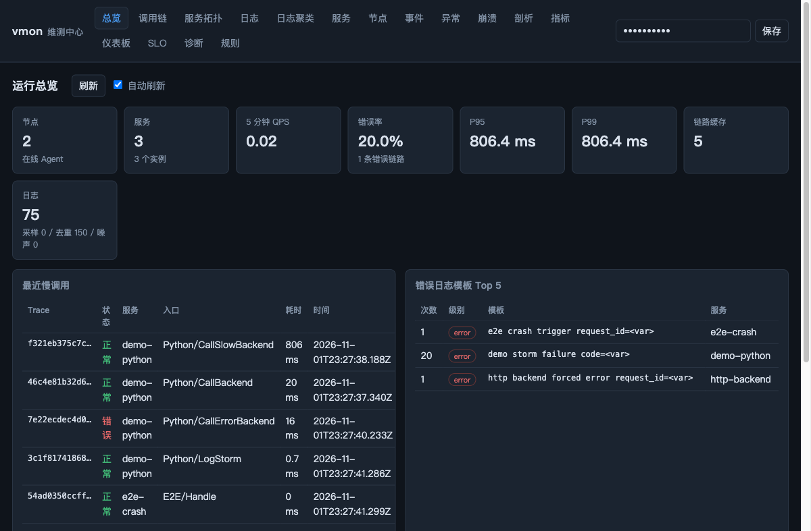
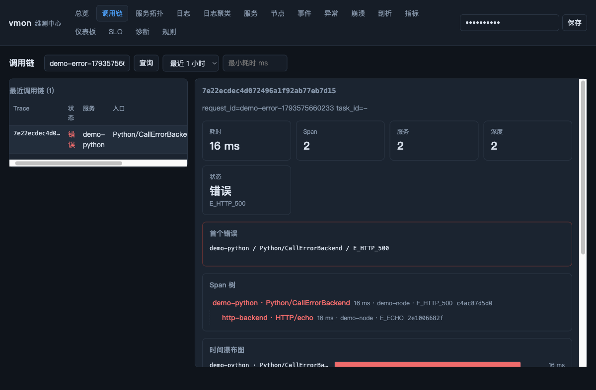
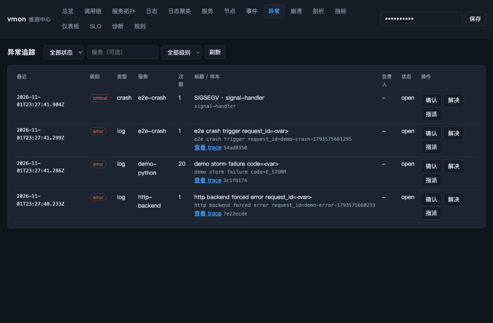
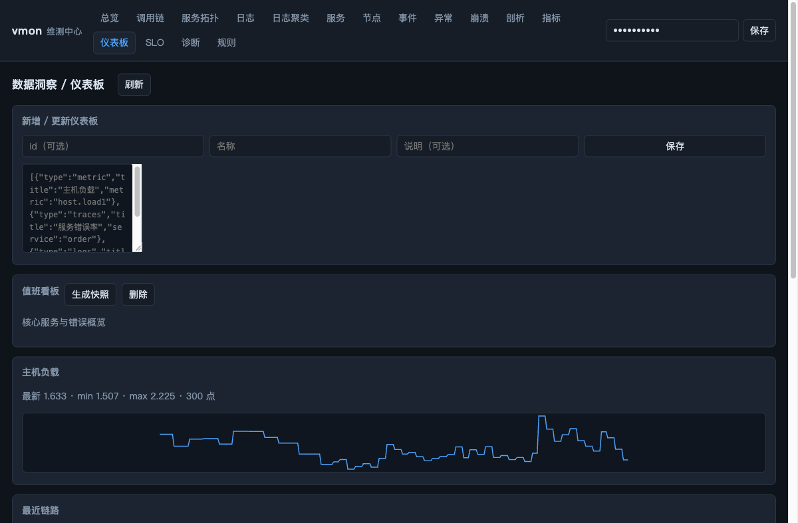

# 示例与演示指南

> 目标：不用读设计文档，也能在几分钟内看到「一条请求如何被串起来」。
> 更完整的排障方法见 [docs/quick-diagnosis.md](../docs/quick-diagnosis.md)，
> 场景说明见 [docs/scenario-cookbook.md](../docs/scenario-cookbook.md)。

## 1. 目录

| 示例 | 作用 | 入口 |
|---|---|---|
| `hello/` | 最小业务接入：多阶段 Span、日志、错误码、两个请求对比 | `examples/hello/run_demo.sh` |
| `http_backend/` | 接收 Python/Web 调用的 C++ HTTP 后端，续接 traceparent | `./build/examples/http_backend/vmon_http_backend` |
| `scenarios/` | 常用场景一键演示：RPC、慢调用、错误、日志风暴、SLO、崩溃 | `examples/scenarios/demo.py` |

## 2. 三分钟跑通

```bash
# 构建
cmake -S . -B build -DCMAKE_BUILD_TYPE=Debug
cmake --build build -j

# 示例 1：最小业务请求
./examples/hello/run_demo.sh
```

脚本会打印 `demo-request-1`（失败）与 `demo-request-2`（成功）的 trace、
日志与 Web UI 地址。

```bash
# 示例 2：保留栈，自己打开 Web UI
DEMO_KEEP=1 ./examples/hello/run_demo.sh
```

```bash
# 示例 3：常用场景（自动起 Server + Agent + HTTP 后端）
python3 examples/scenarios/demo.py --scenario all --keep
```

`--keep` 会保留进程与临时目录，脚本会打印 Web UI 地址、令牌、trace_id、
request_id 和 CLI 命令；按 Ctrl+C 结束。

## 3. Web UI 截图导览

以下截图来自 `examples/scenarios/demo.py --scenario all` 的真实运行结果，
通过 Playwright MCP 对浏览器截图得到。

### 3.1 总览：先判断有没有事



重点看：

- 节点 / 服务 / QPS / 错误率 / P95 / P99；
- 最近慢调用；
- 错误日志模板 Top 5；
- 可用性拨测（UP/DOWN，需 Agent `--probe`）。

### 3.2 调用链：一次错误请求的树与瀑布



重点看：

- 首个错误与错误码（`E_HTTP_500` / `E_ECHO`）；
- Span 树的父子关系（Python client span → C++ server span）；
- 瀑布图与关键路径；
- 关联日志。

### 3.3 异常追踪：错误聚合与处理



重点看：

- 错误模板与崩溃指纹聚合；
- 次数、服务、样本、关联 trace；
- 确认 / 指派 / 解决。

### 3.4 仪表板：团队共用视图与快照



重点看：

- 指标 widget（最新 / min / max + 折线）；
- 链路 widget（数量 / 错误率 / P95）；
- 日志 Top 模板；
- 「生成快照」保存只读证据。

## 4. 各示例说明

### 4.1 hello：最小业务接入

`hello/main.cpp` 模拟：

```
Gateway/Handle
  ├─ Auth/Verify
  ├─ Order/Parse
  ├─ Inventory/Reserve
  │    └─ Cache/Get
  ├─ Payment/Charge（成功请求）
  └─ Response/Build
```

- `demo-request-1`：库存重试两次后失败，根 Span 标记 `E_ORDER_FAILED`；
- `demo-request-2`：完整成功链路。

用 Web UI 搜索 `demo-request-1` 可看到错误传播与关键路径，搜索
`demo-request-2` 可对比正常链路。

### 4.2 http_backend：Python/Web → C++ 后端

```bash
# 先启动栈（scripts/vmon.sh 或 demo.py）
./scripts/vmon.sh up

# 启动后端
VMON_AGENT_ENDPOINT=.vmon-run/agent.sock \
VMON_CONTROL_DIR=.vmon-run/ctrl \
VMON_CRASH_DIR=.vmon-run/crash \
./build/examples/http_backend/vmon_http_backend --port 19090
```

Python 调用：

```python
import sys; sys.path.insert(0, "clients/python")
from vmon_trace import Client

client = Client("http://127.0.0.1:18428", "dev-token",
                service="py-demo", node="node-1")
with client.span("Python/CallBackend", request_id="demo-rpc-1") as span:
    status, body = client.request(
        "POST", "http://127.0.0.1:19090/api/echo",
        body={"hello": "world"}, request_id="demo-rpc-1")
    span.set_attr("http.status_code", status)
client.close()
```

在调用链中搜索 `demo-rpc-1`：Python 是根 Span，`HTTP/echo` 是子 Span。

### 4.3 scenarios：常用场景

```bash
python3 examples/scenarios/demo.py --scenario rpc --keep
python3 examples/scenarios/demo.py --scenario slow --keep
python3 examples/scenarios/demo.py --scenario error --keep
python3 examples/scenarios/demo.py --scenario logstorm --keep
python3 examples/scenarios/demo.py --scenario slo --keep
python3 examples/scenarios/demo.py --scenario crash --keep
python3 examples/scenarios/demo.py --scenario all --keep
```

每个场景会打印 trace_id、request_id、看点与 CLI 命令。

## 5. 手动验证新能力

```bash
BASE=http://127.0.0.1:18428
TOKEN=demo-token
```

**告警静默**：

```bash
curl -s -H "X-Vmon-Token: $TOKEN" -H 'Content-Type: application/json' \
  -d '{"name":"发布窗口","service":"order","duration_minutes":30}' \
  "$BASE/api/silences"
```

**可用性拨测**：启动 Agent 时增加：

```bash
vmon_agent ... --probe 'api=http://127.0.0.1:19090/health;interval_ms=5000'
```

总览会出现「可用性拨测」面板，指标页可查 `probe.up`。

**仪表板**：

```bash
curl -s -H "X-Vmon-Token: $TOKEN" -H 'Content-Type: application/json' \
  -d '{"id":"dash-1","name":"值班看板","widgets":[
       {"type":"metric","title":"负载","metric":"host.load1"},
       {"type":"traces","title":"链路"},
       {"type":"logs","title":"错误模板","limit":5}]}' \
  "$BASE/api/dashboards"
```

然后打开 Web UI →「仪表板」查看。

**异常追踪**：产生错误日志后打开「异常」页，或：

```bash
curl -s -H "X-Vmon-Token: $TOKEN" "$BASE/api/issues?limit=10"
```

## 6. 进一步阅读

- [使用手册](../docs/user-guide.md)
- [快速诊断与定位](../docs/quick-diagnosis.md)
- [常用场景手册](../docs/scenario-cookbook.md)
- [详细模块设计](../docs/module-design.md)
