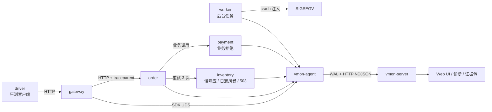
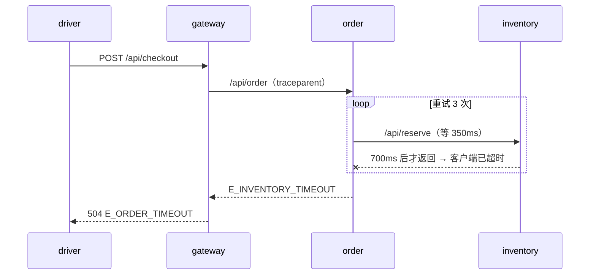

# 故障注入实验室（faultlab）

> 目标：**同一个二进制**、一条命令，复现多进程/跨服务的复杂故障，
> 再用 CplusTrace 的调用链、错误码、日志聚类、一键诊断、崩溃记录和证据包
> 在几分钟内定位到「哪一跳、什么错、为什么」。
>
> 相关文档：[快速诊断手册](../../docs/quick-diagnosis.md) ·
> [常用场景手册](../../docs/scenario-cookbook.md) ·
> [数据血缘示例](../industrial_cpp/README.md)

## 1. 它和已有示例有什么不同

| 示例 | 侧重点 | 局限 |
|---|---|---|
| `examples/hello` | 单进程、最小接入 | 没有真实跨进程调用 |
| `examples/scenarios` | Python 客户端造场景 | 场景分散，业务进程较简单 |
| `examples/multiprocess` | 三进程链路还原 | 只验证链路，不注入故障 |
| `examples/industrial_cpp` | 工业控制 + 数据血缘 | 面向血缘闸门，不是通用排障 |
| **`examples/faultlab`** | **同一二进制的 5 类复杂故障 + 自动诊断报告** | 业务是模拟的，不是真实系统 |

`faultlab` 的特点：

- **一个二进制、六种角色**：`gateway` / `order` / `inventory` / `payment` /
  `worker` / `driver`，全部链接 vmon SDK；
- **真实跨进程链路**：HTTP + W3C `traceparent`，四层服务调用；
- **可切换故障**：`none` / `slow` / `payment` / `lockwait` / `logstorm` / `crash`；
- **自动定位**：脚本跑完自动查询 Server API，打印「现象 → 证据 → 诊断 → 建议 →
  证据包」的结构化报告，并写入 Markdown 文件。

## 2. 架构

**进程与故障注入点**：



**以 `slow` 为例的调用时序**（超时 + 重试放大）：



- 进程内 Span：`Gateway/Checkout` → `Order/Create` → `Inventory/Reserve`、
  `Payment/Charge`；
- 跨进程：每个请求把当前 Span 的 `traceparent` 放进 HTTP body 传给下游；
- `order` 对 `inventory` 有 **3 次重试**，用来演示超时放大；
- 日志统一带 `request_id`，Server 自动把日志挂到对应 trace 上。

## 3. 快速开始

### 3.1 构建

```bash
cmake -S . -B build -DCMAKE_BUILD_TYPE=Debug
cmake --build build -j
# 产物：build/examples/faultlab/vmon_faultlab
```

### 3.2 跑一个场景（推荐入口）

```bash
python3 examples/faultlab/run_demo.py --scenario slow
```

脚本会自动：

1. 选择空闲端口，启动 `vmon_server` + `vmon_agent`；
2. 启动 4 个业务进程（gateway/order/inventory/payment）；
3. 按场景注入故障，运行 driver 产生请求；
4. 轮询 Server API，等到 trace / 日志 / 崩溃数据完整；
5. 打印诊断报告，并写入 `report-<场景>.md`。

### 3.3 保留栈，自己打开 Web UI

```bash
python3 examples/faultlab/run_demo.py --scenario payment --keep
```

`--keep` 会保留 Server、Agent 和业务进程；终端会打印 Web UI 地址和代表
`request_id`。按 `Ctrl+C` 结束。

### 3.4 一次跑完全部场景

```bash
python3 examples/faultlab/run_demo.py --scenario all
```

`all` 会在同一个 Server/Agent 上依次运行 6 个场景（`none` + 5 类故障），
每个场景使用独立的业务进程和端口，互不干扰。

### 3.5 指定构建目录或二进制

```bash
python3 examples/faultlab/run_demo.py --scenario slow \
  --server-bin build/vmon_server \
  --agent-bin build/vmon_agent \
  --client-bin build/examples/faultlab/vmon_faultlab
```

脚本默认先找 `build/`，再找 `build-dev/`。

## 4. 场景清单

| 场景 | 命令 | 注入 | 预期诊断结论 |
|---|---|---|---|
| 健康基线 | `--scenario none` | 无 | `evidence_insufficient`（无异常） |
| 下游超时 | `--scenario slow` | inventory 700ms；order 350ms 超时 ×3 重试 | `downstream_timeout` |
| 业务错误 | `--scenario payment` | payment 每 3 次拒绝一次 | `business_error` |
| 锁等待 | `--scenario lockwait` | order 持锁 2500ms，4 并发请求排队 | `lock_contention` |
| 日志风暴 | `--scenario logstorm` | 每次 300 INFO + 10 ERROR，隔次 503 | `business_error` + 聚类降噪 |
| 进程崩溃 | `--scenario crash` | worker 空指针 → SIGSEGV | 崩溃记录 + 巡检 `crashes=fail` |

每个场景的报告包含：

```
现象（请求成功率 / HTTP 状态）
调用链（Span 树 / 首个错误 / 最慢 Span / 关键路径 / 关联日志）
错误码传播（跨服务聚合 + sample_path）
日志聚类 Top（按次数）+ 采样/去重计数
一键诊断（verdict / 假设 / 建议 / 巡检异常项）
崩溃记录（crash 场景）
证据包（id / 文件数 / 目录）
复现命令与观察要点
```

## 5. 逐个场景说明

### 5.1 `none`：健康基线

- **注入**：无。
- **预期**：6 个请求全部 200；trace 含 6 个 Span、4 个服务；无错误码。
- **用途**：和故障场景对比，确认「不是工具本身在报错」。
- **观察**：总览无错误率、无慢调用；日志聚类都是正常业务模板。

### 5.2 `slow`：下游慢调用 + 超时 + 重试放大

- **注入**：`inventory` 每次响应前 `sleep 700ms`；`order` 每次只等 350ms，
  失败后重试 3 次；`gateway` 等 `order` 600ms。
- **现象**：gateway 返回 `504`；一次请求里出现 **3 个**
  `Inventory/Reserve` 客户端 Span，每个约 350ms，全部带
  `E_INVENTORY_TIMEOUT`；`order` 的 Span 约 1.05s。
- **自动结论**：`downstream_timeout`，最慢 Span 指向 `Order/Create`，
  关键路径末端是 `Inventory/Reserve`。
- **手工验证**：

  ```bash
  BASE=http://127.0.0.1:<port>
  RID=<报告里的代表请求>
  curl -s "$BASE/api/requests/$RID" | python3 -m json.tool | head -80
  curl -s "$BASE/api/error-codes?limit=10"
  curl -s -H 'Content-Type: application/json' \
    -d "{\"request_id\":\"$RID\"}" "$BASE/api/diagnose"
  ```

- **定位顺序**：首个错误 → 最慢 Span → 关键路径 → 该 Span 的日志（重试次数）
  → 下游服务日志（是否真的慢）。
- **易错点**：不要把「上游超时」当成根因；真正的慢点在最下游的
  `Inventory/Reserve`。

### 5.3 `payment`：业务错误码跨服务传播

- **注入**：`payment` 对迭代号为 3 的倍数的请求返回
  `E_PAYMENT_DECLINED`。
- **现象**：`payment → order → gateway` 三层 Span 都带同一个错误码；
  gateway 返回 `502`。
- **自动结论**：`business_error`；错误码页显示
  `E_PAYMENT_DECLINED` 涉及 3 个服务，`sample_path` 完整展示传播路径。
- **手工验证**：

  ```bash
  curl -s "$BASE/api/error-codes?limit=10" | python3 -m json.tool
  curl -s "$BASE/api/issues?limit=10" | python3 -m json.tool
  ```

- **定位顺序**：错误码聚合 → `sample_path` 最深的服务 → 该服务日志
  （`payment declined: card expired`）。
- **易错点**：业务错误码是「结果」，不是「根因」；要看到最深的业务服务。

### 5.4 `lockwait`：锁等待 / 线程阻塞

- **注入**：`order` 的第一个请求持有全局锁 2500ms；driver 用 4 并发请求，
  其余请求阻塞在锁上；`gateway` 只等 600ms。
- **现象**：4 个请求全部 `504`；`order` 的 Span 时长约 2.5s；
  日志出现 `order lock wait exceeded 800ms waited_ms=2504`。
- **自动结论**：`lock_contention`（诊断规则识别日志中的 `lock wait`）。
- **手工验证**：

  ```bash
  curl -s "$BASE/api/traces/<trace_id>" | python3 -m json.tool | \
    python3 -c 'import sys,json; print(json.load(sys.stdin)["threads"])'
  # Linux 上还可以抓全线程栈：
  curl -s -H 'Content-Type: application/json' \
    -d '{"node":"faultlab-node","pid":<order-pid>}' \
    "$BASE/api/control/dump-stacks"
  ```

- **定位顺序**：线程时间线长空档 → `order` 日志 `lock wait` →
  （Linux）全线程栈确认持锁者。
- **平台限制**：SDK 的 `dump_stacks` 只在 Linux 实现；macOS 上诊断仍能通过
  日志与线程时间线给出 `lock_contention`。

### 5.5 `logstorm`：日志风暴 + 队列过载

- **注入**：`inventory` 每次请求打 300 条 INFO（`inventory scan item=...`）
  + 10 条 ERROR（`queue depth exceeded`）；迭代号为偶数时返回
  `E_INVENTORY_OVERLOADED`（503）。
- **现象**：请求 5 成功 / 5 失败；日志聚类中同一个模板出现约 2000 次，
  错误模板约 40 次；总览出现去重计数。
- **自动结论**：`business_error`；报告同时展示日志治理计数与 Top 模板。
- **手工验证**：

  ```bash
  curl -s "$BASE/api/logs/clusters?limit=50" | python3 -m json.tool | head -60
  curl -s "$BASE/api/overview" | python3 -m json.tool | \
    grep -E 'log_count|logs_sampled|logs_deduped|logs_noise'
  ```

- **定位顺序**：先看模板聚类（次数最多的模板），再看错误模板，最后按指纹
  下钻代表样本；**不要逐条翻日志**。

### 5.6 `crash`：后台进程崩溃

- **注入**：`worker` 第 8 个 tick（约 2 秒）模拟空指针解引用；SDK 崩溃处理器
  写入最小 JSON；Agent 扫描崩溃目录并上传。
- **现象**：worker 退出码 `139`（SIGSEGV）；崩溃页出现
  `faultlab-worker / SIGSEGV`；巡检 `crashes=fail`。
- **自动结论**：崩溃记录是直接证据；报告中给出信号、pid、节点与次数。
- **手工验证**：

  ```bash
  curl -s "$BASE/api/crashes?service=faultlab-worker" | python3 -m json.tool
  curl -s "$BASE/api/inspection?service=faultlab-worker" | python3 -m json.tool
  ```

- **符号化**：崩溃 JSON 记录了二进制路径与信号；若保留 debuginfo，可用
  `POST /api/crashes/symbolize` 对地址做离线符号化。
- **注意**：崩溃处理器默认关闭，本示例的 worker 显式开启；生产环境建议优先
  使用平台的 core 收集，详见 [部署手册](../../docs/deployment.md)。

## 6. 报告怎么读

以 `slow` 为例：

```
首个错误   : faultlab-gateway / Gateway/Checkout / E_ORDER_TIMEOUT
最慢 Span  : faultlab-order / Order/Create（1054.2 ms）
关键路径   : gateway/Gateway/Checkout → order/Order/Create
             → order/Inventory/Reserve → inventory/Inventory/Reserve
Span 树：
  gateway Gateway/Checkout        601.8 ms E_ORDER_TIMEOUT
    order Order/Create           1054.2 ms E_INVENTORY_TIMEOUT
      order Inventory/Reserve      351.5 ms E_INVENTORY_TIMEOUT
        inventory Inventory/Reserve 702.6 ms
      ...（重试 3 次）
```

读法：

1. **首个错误**告诉你「哪一层先报错」，但它可能只是上游超时；
2. **最慢 Span** 告诉你时间花在哪里；
3. **关键路径**从根走到最慢叶子，避免在无关分支上浪费时间；
4. **Span 树里的重复节点**（3 次 `Inventory/Reserve`）就是重试；
5. **错误码传播路径**告诉你同一个码影响了哪些服务；
6. **诊断结论**是规则化假设，仍需用日志/线程栈验证。

## 7. 手工分终端运行（不用脚本）

```bash
# 终端 1：Server
./build/vmon_server --listen-host 127.0.0.1 --port 18428 \
  --state-dir /tmp/faultlab-server --web-dir web --no-forward

# 终端 2：Agent
./build/vmon_agent --server-url http://127.0.0.1:18428 \
  --uds /tmp/faultlab-agent.sock --state-dir /tmp/faultlab-agent \
  --node faultlab-node --control-dir /tmp/faultlab-ctrl \
  --crash-dir /tmp/faultlab-crash --upload-interval-ms 100

# 终端 3-6：业务进程（以 slow 为例）
BIN=./build/examples/faultlab/vmon_faultlab
$BIN --role inventory --port 19103 --agent /tmp/faultlab-agent.sock \
  --control-dir /tmp/faultlab-ctrl --fault slow &
$BIN --role payment   --port 19104 --agent /tmp/faultlab-agent.sock \
  --control-dir /tmp/faultlab-ctrl --fault slow &
$BIN --role order     --port 19102 --agent /tmp/faultlab-agent.sock \
  --control-dir /tmp/faultlab-ctrl --fault slow \
  --inventory-port 19103 --payment-port 19104 &
$BIN --role gateway   --port 19101 --agent /tmp/faultlab-agent.sock \
  --control-dir /tmp/faultlab-ctrl --fault slow --order-port 19102 &

# 终端 7：driver
$BIN --role driver --gateway-port 19101 --iterations 5 --request-prefix manual
```

然后打开 `http://127.0.0.1:18428/`，搜索 driver 打印的 `request_id`。

## 8. 参数与故障码

### 8.1 二进制参数

| 参数 | 说明 |
|---|---|
| `--role` | `gateway` / `order` / `inventory` / `payment` / `worker` / `driver` |
| `--fault` | `none` / `slow` / `payment` / `lockwait` / `logstorm` / `crash` |
| `--port` | 控制器监听端口 |
| `--order-port` / `--inventory-port` / `--payment-port` | 下游端口 |
| `--gateway-port` | driver 访问的 gateway 端口 |
| `--iterations` | driver 请求数 |
| `--concurrency` | driver 并发数（`lockwait` 必须 > 1） |
| `--agent` | Agent UDS 路径 |
| `--control-dir` | SDK 控制通道目录 |
| `--crash-dir` | 崩溃报告目录（与 Agent `--crash-dir` 一致） |

### 8.2 故障码

| 错误码 | 产生位置 | 含义 |
|---|---|---|
| `E_INVENTORY_TIMEOUT` | order 的 inventory 客户端 Span | 350ms 内未拿到 inventory 响应 |
| `E_INVENTORY_OVERLOADED` | inventory / order / gateway | inventory 队列过载，返回 503 |
| `E_PAYMENT_DECLINED` | payment / order / gateway | 支付被拒绝 |
| `E_PAYMENT_TIMEOUT` | order 的 payment 客户端 Span | payment 800ms 未响应 |
| `E_ORDER_TIMEOUT` | gateway | 600ms 内未拿到 order 响应 |
| `E_ORDER_LOCK_WAIT` | order | 等待全局锁超过 800ms |
| `E_HANDLER_EXCEPTION` | 任一控制器 | 请求处理抛出异常（兜底） |

## 9. 限制与注意事项

- 示例是**故意注入故障**的，不用于性能基准；
- `dump_stacks` 只在 Linux 实现，macOS 上相关建议会退化为「看线程时间线 + 日志」；
- 崩溃符号化需要保留 debuginfo（Debug 构建或单独的符号文件）；
- 脚本使用临时目录，`--keep` 时目录会保留并在退出时打印路径；
- 默认监听 `127.0.0.1`，只在开发机演示；内网部署请参考
  [部署手册](../../docs/deployment.md)。
