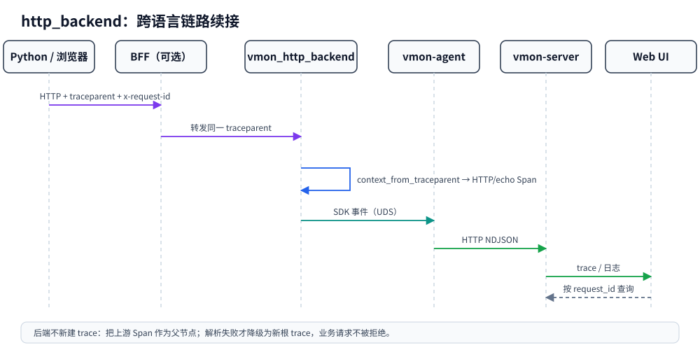
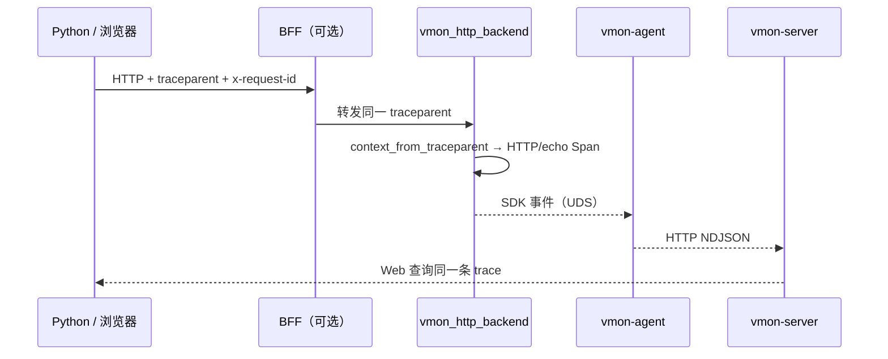

# http_backend：Python / Web → C++ 后端的链路续接

> 目标：验证上游不是「链路的盲区」——Python 或浏览器发起的请求，可以在
> C++ 后端继续同一条 trace。
> 关联文档：[client-observability.md](../../docs/client-observability.md)、
> [scenario-cookbook.md](../../docs/scenario-cookbook.md)。

## 1. 这个示例演示什么

`vmon_http_backend` 是一个最小的 C++ HTTP 服务，链接 vmon SDK：

- 从 `traceparent` 头恢复父上下文，创建 `HTTP/echo` server span；
- 从 `x-request-id` / `x-task-id` 恢复业务关联 ID；
- SDK 未初始化或 Agent 不在线时，HTTP 服务照常工作（fail-open）；
- 支持强制错误与可控耗时，用来演示错误链路和慢调用。

它通常作为 [scenarios](../scenarios/README.md) 里的后端，也可以单独接入
Python / 浏览器客户端。

## 1.1 原理流程



<details>
<summary>Mermaid 源码（可编辑）</summary>



</details>

关键点：后端**不新建 trace**，而是把上游 Span 作为父节点；解析失败时才
降级为新的根 trace，业务请求不会被拒绝。

## 2. 文件与构建

| 文件 | 作用 |
|---|---|
| `main.cpp` | HTTP 服务、traceparent 续接、错误/耗时注入 |
| `CMakeLists.txt` | 构建目标 `vmon_http_backend` |

```bash
cmake -S . -B build -DCMAKE_BUILD_TYPE=Debug
cmake --build build -j
# 产物：build/examples/http_backend/vmon_http_backend
```

## 3. 启动

### 3.1 先启动 Server + Agent

```bash
./scripts/vmon.sh up
# 或手工启动，见 examples/hello/README.md
```

### 3.2 启动后端

```bash
VMON_AGENT_ENDPOINT=.vmon-run/agent.sock \
VMON_CONTROL_DIR=.vmon-run/ctrl \
VMON_CRASH_DIR=.vmon-run/crash \
./build/examples/http_backend/vmon_http_backend --port 19090
```

参数：

| 参数 | 默认 | 说明 |
|---|---|---|
| `--host` | `127.0.0.1` | 监听地址 |
| `--port` | `19090` | 监听端口 |

环境变量：

| 变量 | 说明 |
|---|---|
| `VMON_AGENT_ENDPOINT` | Agent UDS 路径 |
| `VMON_CONTROL_DIR` | 控制通道目录（动态日志级别等） |
| `VMON_CRASH_DIR` | 崩溃报告目录 |

启动成功会打印：

```
http backend READY host=127.0.0.1 port=19090
```

## 4. 接口

| 方法 | 路径 | 说明 |
|---|---|---|
| `GET` | `/health` | 健康检查，返回 `{"ok":true}` |
| `GET` / `POST` | `/api/echo` | 回显请求，创建 `HTTP/echo` Span |

支持的请求头：

| 头 | 作用 |
|---|---|
| `traceparent` | W3C 上下文；有则续接，无则新建 trace |
| `x-request-id` | 业务请求号，写入日志与 trace |
| `x-task-id` | 任务号 |
| `x-vmon-force-error` | 非空时返回 500 并标记 `E_ECHO` |
| `x-vmon-sleep-ms` | 模拟处理耗时，范围 0–5000ms，默认 15ms |

## 5. 用 Python 客户端调用

```python
import sys
sys.path.insert(0, "clients/python")
from vmon_trace import Client

client = Client("http://127.0.0.1:18428", service="py-demo", node="node-1")
with client.span("Python/CallBackend", request_id="demo-rpc-1") as span:
    status, body = client.request(
        "POST", "http://127.0.0.1:19090/api/echo",
        body={"hello": "world"}, request_id="demo-rpc-1")
    span.set_attr("http.status_code", status)
client.close()
```

预期 trace：

```
demo-python / Python/CallBackend        （客户端 Span）
  └─ http-backend / HTTP/echo           （服务端 Span，parent = 客户端 Span）
```

在 Web UI 搜索 `demo-rpc-1`，可以看到两个服务在同一条 trace 里。

## 6. 用浏览器客户端调用

浏览器不要直连中心写接口，事件经 BFF 汇总：

```js
import { instrumentFetch } from "/static/vmon-trace.js";

const tracedFetch = instrumentFetch({
  service: "web-bff",
  requestId: "web-1",
  endpoint: "/v1/ingest",   // 由 BFF 转发到中心
});

await tracedFetch("/api/echo", { method: "POST" });
```

后端通过 `vmon::context_from_traceparent()` 续接，详见
[client-observability.md](../../docs/client-observability.md)。

## 7. 手工验证

### 7.1 不带 traceparent（后端新建 trace）

```bash
curl -s -X POST http://127.0.0.1:19090/api/echo \
  -H 'x-request-id: manual-1' \
  -H 'Content-Type: application/json' \
  -d '{"hello":"world"}'
```

后端会新建一条 trace，根 Span 是 `HTTP/echo`。

### 7.2 带 traceparent（续接上游）

```bash
# 任意合法 trace_id / span_id；最后一个 01 表示采样
TP='00-4bf92f3577b34da6a3ce929d0e0e4736-00f067aa0ba902b7-01'

curl -s -X POST http://127.0.0.1:19090/api/echo \
  -H "traceparent: $TP" \
  -H 'x-request-id: manual-2' \
  -H 'Content-Type: application/json' \
  -d '{"hello":"world"}'
```

在中心按 `trace_id=4bf92f3577b34da6a3ce929d0e0e4736` 查询，可看到后端
`HTTP/echo` 的父 Span 是 `00f067aa0ba902b7`。

### 7.3 强制错误

```bash
curl -i -X POST http://127.0.0.1:19090/api/echo \
  -H 'x-request-id: manual-error' \
  -H 'x-vmon-force-error: 1'
```

预期：HTTP 500；trace 中 `HTTP/echo` 带 `E_ECHO`；Web UI 错误码页出现该码。

### 7.4 慢调用

```bash
curl -s -X POST http://127.0.0.1:19090/api/echo \
  -H 'x-request-id: manual-slow' \
  -H 'x-vmon-sleep-ms: 800'
```

预期：`slowest_span` 指向 `HTTP/echo`，耗时约 800ms。

## 8. 代码要点

### 8.1 续接 traceparent

```cpp
vmon::SpanContext parent;
const std::string traceparent = req.get_header_value("traceparent");
const bool has_parent =
    vmon::context_from_traceparent(traceparent.c_str(), &parent);

vmon::Span span = has_parent
    ? vmon::create_span_with_parent(parent, "HTTP/echo", __FILE__, __LINE__)
    : vmon::Span::create("HTTP/echo", __FILE__, __LINE__);
```

解析失败时**不要拒绝业务请求**，新建 trace 即可。

### 8.2 request_id 的生命周期

SDK 只保存指针，后台发送线程稍后才序列化。HTTP 框架的 header 字符串在
handler 返回后可能失效，因此示例用有界队列持有字符串：

```cpp
const char* KeepId(const std::string& id) {
  static std::mutex mutex;
  static std::deque<std::string> ids;
  std::lock_guard<std::mutex> lock(mutex);
  ids.push_back(id);
  while (ids.size() > 4096) ids.pop_front();
  return ids.back().c_str();
}
```

`std::deque` 的 `push_back` 不会让已有元素的指针失效。

### 8.3 请求结束清理

```cpp
vmon::set_request_id(nullptr);
vmon::set_task_id(nullptr);
```

HTTP 服务器会复用线程；不清理会把上一个请求的 ID 带到下一个请求。

## 9. 常见问题

| 现象 | 原因 | 处理 |
|---|---|---|
| 后端 Span 变成根 Span | 上游没有传 `traceparent` 或格式非法 | 检查客户端注入；后端会新建 trace 而不是报错 |
| 日志没有 request_id | 上游没有传 `x-request-id` | 客户端补头；或由 BFF 生成 |
| `vmon disabled, business continues` | SDK 初始化失败 | 服务仍可用；检查 `service_name` 与 Agent |
| 查询不到后端日志 | Agent UDS 不一致或上传延迟 | 检查 `VMON_AGENT_ENDPOINT`，等 1 秒再查 |
| 500 但不是业务错误 | 传了 `x-vmon-force-error` | 该头就是用于演示错误链路 |

## 10. 相关示例

- [hello](../hello/README.md)：最小单进程接入；
- [scenarios](../scenarios/README.md)：一键跑跨语言 RPC / 慢调用 / 错误；
- [multiprocess](../multiprocess/README.md)：纯 C++ 多进程链路；
- [faultlab](../faultlab/README.md)：复杂故障注入与自动诊断。
