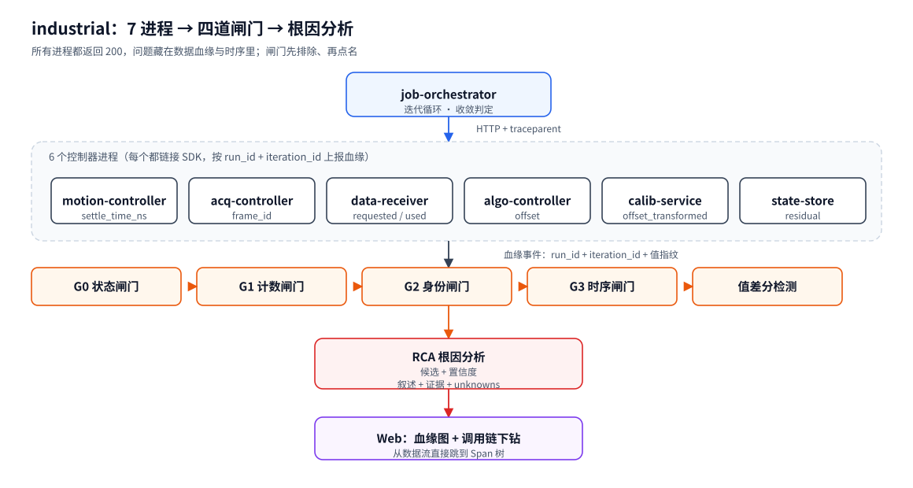
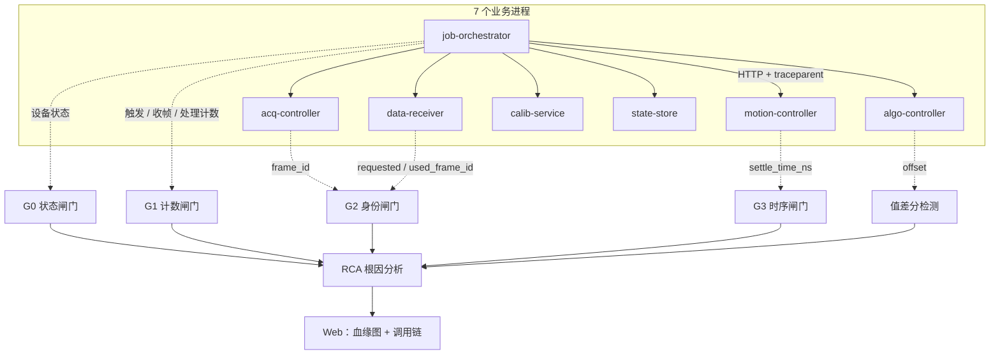
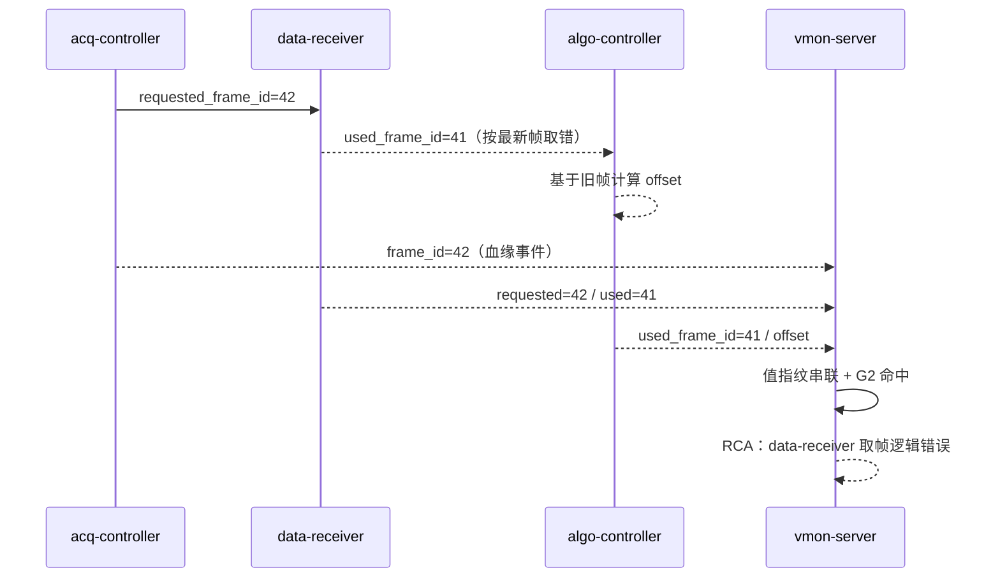

# 工业控制闭环示例：用数据血缘快速定位故障

这个示例用 **7 个真实进程**模拟一套工业视觉检测系统，复现两类"**所有状态码都正常、
但结果不对**"的故障，并演示 vmon 如何用**前置闸门 + 数据血缘 + 根因分析**在几分钟内定位。

> 需要 **C++ 业务进程 + SDK 埋点**的接入示例？见
> [examples/industrial_cpp](../industrial_cpp/README.md)（走真实 SDK → Agent → Server）。

- 逻辑层：`job-orchestrator`（迭代循环、收敛判定）
- 控制器：`motion-controller` / `acq-controller` / `data-receiver` /
  `algo-controller` / `calib-service` / `state-store`

每个进程都会把 **span / 血缘（值指纹）/ 设备状态** 事件发到 `vmon-server`，
Server 按 `run_id + iteration_id` 拼接出跨进程血缘图，并跑四道前置闸门。

## 0. 原理框架

**7 个进程 + 四道闸门 + 根因分析**：



<details>
<summary>Mermaid 源码（可编辑）</summary>



</details>

**数据血缘如何跨进程传递**（以身份错位为例）：



---

## 1. 先编译

```bash
./scripts/build.sh --no-tests --no-examples -j 8
# 产物：build/vmon_server
```

> 示例本身是 Python 脚本，只依赖标准库；它对接的是真实的 C++ Server。

## 2. 一键跑通（脚本自己起 Server）

```bash
# 身份错位故障（默认）
python3 examples/industrial/run_demo.py --start-server --server-bin build/vmon_server --port 18428

# 时序耦合故障
python3 examples/industrial/run_demo.py --start-server --server-bin build/vmon_server --port 18428 --fault timing
```

## 3. 已有 Server 时直接跑

```bash
./scripts/vmon.sh up            # 或手动起 vmon_server
python3 examples/industrial/run_demo.py --server http://127.0.0.1:18428 --fault identity
```

保留进程便于打开 Web UI：

```bash
python3 examples/industrial/run_demo.py --server http://127.0.0.1:18428 --keep
```

---

## 4. 两种故障模式

| 模式 | 复现方式 | 命中 | verdict |
|---|---|---|---|
| `identity` | `data-receiver` 按"最新帧"响应，取到上一帧 | G2 身份 | `identity_mismatch` |
| `timing` | 某次迭代运动 `settle=13.1ms` > 触发延时 `10ms` | G3 时序 | `timing_violation` |
| `count` | 第 10 次迭代丢一帧，触发 30 / 收帧 29 | G1 计数 | `cardinality_mismatch` |
| `state` | 运动控制器启动状态为 `disabled` | G0 状态 | `state_precondition_violation` |
| `algo` | 第 20 次迭代算法 offset 从 1.0 跳到 3.7 | 闸门全过，靠差分 | `value_deviation` |
| `none` | 正常，用作对照 | 无 | `evidence_insufficient`（不误报） |

所有故障模式都满足：
- 7 个进程全部返回 200，**没有任何错误码**；
- 计数一致（触发数 = 收帧数 = 处理数 = 迭代数）；
- 设备状态全部满足契约。

也就是说，**传统按错误码/日志的排障方式无从下手**。

---

## 5. 输出怎么读

脚本会打印三块内容。

### 5.1 前置闸门

```
✔  G0    失败迭代=0     设备状态/使能
✔  G1    失败迭代=0     触发数=收帧数=处理数=迭代数
✘  G2    失败迭代=42    used_frame_id == requested_frame_id
✔  G3    失败迭代=0     trigger_delay >= settle_time
```

闸门是**先排除、先点名**：G0/G1 通过，说明"没初始化、没使能、丢帧重帧"都被排除，
问题被直接收缩到身份/时序这一层。

### 5.2 根因分析

```
verdict   : identity_mismatch
confidence: 0.86
叙述      : run ... 第 2 次迭代：闸门 G2 命中；请求帧 2，实际使用 1。
候选：
  - data-receiver   score=0.86  按最新帧响应，未按 frame_id 取帧
  - algo-controller score=0.55  消费了错误帧，基于旧位置计算 offset
待确认：
  - 抖动来自相机负载还是节点间网络
```

### 5.3 实例血缘图

`/api/lineage/graph` 返回某次迭代的跨进程字段传播：
`acq.frame_id → receiver.requested/used_frame_id → algo.used_frame_id → offset`，
并用值指纹把"同一个值"的上下游连起来。

Web 页把它画成**服务方框图（SVG）**，每个方框列出该服务的输入/输出字段；
**点击方框会跳到该迭代的 trace 链路图**（Span 树 + 瀑布图），从"数据流"直接下钻到"调用链"。

---

## 6. 在 Web UI 里看

打开 `http://<server>:18428/`，点击导航「**数据血缘**」：

- 左侧列出所有 run；
- 右上显示 G0–G3 闸门与首个失败迭代的详情；
- 下方是根因分析（verdict / 置信度 / 候选 / 偏离基线 / 待确认）；
- 最下方是**实例血缘图（SVG 方框图）**：服务为节点、值传播为边、方框内列出字段；
  点击服务可跳到该迭代的 trace 链路图。

## 7. 用 MCP 让 AI 读取

Server 已内置只读 MCP 工具，`tools/vmon_mcp` 会桥接到 `/mcp`：

| 工具 | 用途 |
|---|---|
| `lineage_runs` | 列出作业运行 |
| `lineage_gates` | 查看某 run 的闸门结果 |
| `lineage_rca` | 对某 run 做根因分析 |
| `lineage_graph` | 查看某迭代的血缘图 |

示例（stdio JSON-RPC）：

```json
{"jsonrpc":"2.0","id":1,"method":"tools/call","params":{"name":"lineage_rca","arguments":{"run_id":"run-xxxxxxxx"}}}
```

---

## 7.1 接入 AI 诊断（可选）

确定性证据之上可以再接一层 AI，用来生成机制假设、排查清单和自然语言解释。
`ai_diagnose.py` 支持两种模式：

```bash
# 有 OpenAI 兼容端点（Ollama / vLLM / 内网网关）
python3 examples/industrial/ai_diagnose.py --server http://127.0.0.1:18428 \
  --run-id run-xxxxxxxx \
  --endpoint http://127.0.0.1:11434/v1 --model qwen2.5:7b

# 没有端点：输出证据包 + 提示词，交给任意 Agent / 人工复核
python3 examples/industrial/ai_diagnose.py --server http://127.0.0.1:18428 \
  --run-id run-xxxxxxxx --evidence-only
```

原则：**确定性证据先算好，AI 只做综合与解释**；每条结论必须引用 `evidence_id`，
引用不上就标 `unknown`。实测结论：AI 的增益在"解释 + 下一步"，不改变"能否发现"——
发现和定位由闸门/差分完成。

## 8. 直接调 API

```bash
# 最近的血缘 run
curl -s 'http://127.0.0.1:18428/api/lineage/runs'
# 闸门
curl -s 'http://127.0.0.1:18428/api/lineage/gates?run_id=run-xxxxxxxx'
# 根因分析
curl -s 'http://127.0.0.1:18428/api/lineage/rca?run_id=run-xxxxxxxx'
# 某迭代的实例血缘图
curl -s 'http://127.0.0.1:18428/api/lineage/graph?run_id=run-xxxxxxxx&iteration_id=37'
```

---

## 9. 文件说明

| 文件 | 作用 |
|---|---|
| `vmon_lineage.py` | 血缘事件发射器：把 span / lineage / state 以 NDJSON 发到 `/v1/ingest` |
| `controller.py` | 7 个角色的进程实现；`--fault identity|timing` 切换故障 |
| `run_demo.py` | 启动进程、跑作业、查询闸门与 RCA 并打印 |

## 10. 接到自己的业务上

1. **自动**：如果业务用 protobuf/JSON，可在传输边界自动提取字段（框架侧）；
2. **声明式**：用 YAML 描述"哪些字段是 in/out、哪些敏感"（见设计文档）；
3. **显式**：在关键边界调用 `emitter.data(run_id, iteration_id, op, [...])`，
   每字段一行；状态用 `emitter.state(run_id, iteration_id, device, state)`。

最小接入只需要三样东西：`run_id`、`iteration_id`、以及**你想追的字段**。

更完整的设计与算法见 [docs/data-lineage-design.md](../../docs/data-lineage-design.md)。
