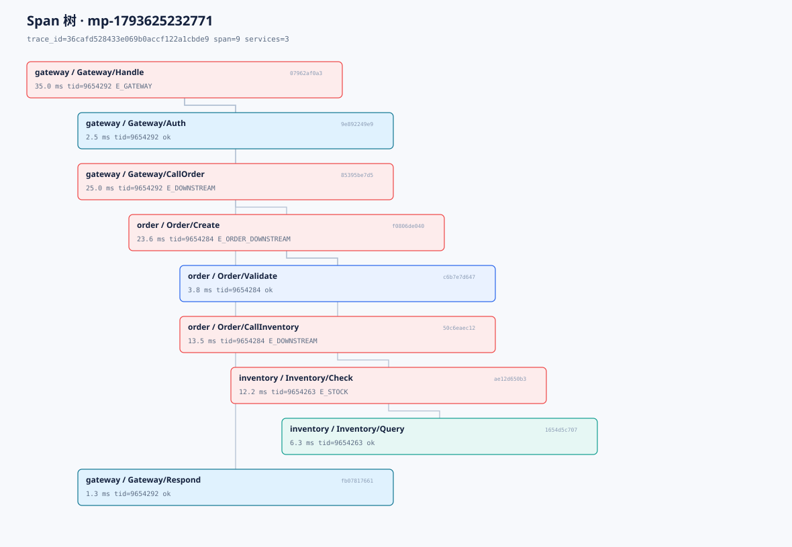

# 多进程调用链示例

一条请求经过三个**独立进程**：

```
Gateway（根 Span）
  → Order（续接父上下文）
    → Inventory（产生 E_STOCK 业务错误）
```

三个进程都链接静态 SDK，通过 HTTP 头传播 W3C `traceparent`；Server 根据
`trace_id/span_id/parent` 还原整棵树。

## 运行

```bash
./scripts/build.sh          # 构建 vmon_multiprocess
python3 examples/multiprocess/run_demo.py

# 保留 Server/Agent/三个进程，打开 Web UI
python3 examples/multiprocess/run_demo.py --keep
```

脚本会：

1. 启动 `vmon_server`、`vmon_agent`；
2. 启动 inventory / order / gateway 三个进程；
3. 调用 `Gateway /call`；
4. 等待 trace 到达；
5. 打印 ASCII Span 树；
6. 生成 SVG 树图（默认 `/tmp/vmon-trace-tree.svg`）。

示例树图（SVG）：



示例输出：

```
gateway / Gateway/Handle  35.0 ms  tid=...  E_GATEWAY
├─ gateway / Gateway/Auth  2.5 ms  tid=...  ok
├─ gateway / Gateway/CallOrder  24.9 ms  tid=...  E_DOWNSTREAM
│  └─ order / Order/Create  23.4 ms  tid=...  E_ORDER_DOWNSTREAM
│     ├─ order / Order/Validate  3.8 ms  tid=...  ok
│     └─ order / Order/CallInventory  14.0 ms  tid=...  E_DOWNSTREAM
│        └─ inventory / Inventory/Check  12.6 ms  tid=...  E_STOCK
│           └─ inventory / Inventory/Query  6.3 ms  tid=...  ok
└─ gateway / Gateway/Respond  1.3 ms  tid=...  ok
```

`--keep` 时会打印 Web UI 地址，搜索 `request_id` 可以看到同样的树、瀑布图和
错误传播链。

## 关键代码

### 1. 入口：从 traceparent 恢复父上下文

`examples/multiprocess/main.cpp`：

```cpp
vmon::SpanContext parent;
const bool has_parent = vmon::context_from_traceparent(
    req.get_header_value("traceparent").c_str(), &parent);

vmon::Span root = has_parent
    ? vmon::create_span_with_parent(parent, root_name, __FILE__, __LINE__)
    : vmon::Span::create(root_name, __FILE__, __LINE__);
```

- 有 `traceparent`：沿用 trace_id，parent = 上游 span_id；
- 没有：新建 trace，成为根 Span。

### 2. 出口：把当前 Span 写成 traceparent

```cpp
vmon::SpanContext ctx = vmon::current_context();
headers.emplace("traceparent",
    vmon::adapters::make_traceparent(ctx.trace_hi, ctx.trace_lo,
                                     ctx.span, true));
headers.emplace("x-request-id", request_id);
headers.emplace("x-task-id", task_id);
```

- `traceparent` 只带 trace/span；
- `request_id/task_id` 走独立 header；
- 下游继续续接，trace_id 全程不变。

### 3. 进程内：作用域自动父子

```cpp
{
  VMON_SPAN("Gateway/Auth");   // 自动 parent = Gateway/Handle
  SleepMs(2);
}
{
  vmon::Span call =
      vmon::Span::create("Gateway/CallOrder", __FILE__, __LINE__);
  CallNext(options.next, ...);  // 下游 parent = Gateway/CallOrder
  call.end();
}
```

### 4. 错误回传

Inventory 设置 `E_STOCK` 并返回 500；Order/Gateway 在收到非 200 时标记
`E_DOWNSTREAM`，因此整条链路同时保留：

- 根因错误：`E_STOCK`
- 传播错误：`E_DOWNSTREAM` / `E_ORDER_DOWNSTREAM` / `E_GATEWAY`

这就是“错误码不是结论，要看错误传播链”的例子。

## 文件

| 文件 | 作用 |
|---|---|
| `main.cpp` | 三个角色的业务进程，HTTP + SDK + traceparent |
| `run_demo.py` | 启动栈、发请求、等待 trace、调用绘图 |
| `draw_tree.py` | 把 trace JSON 画成 ASCII 树和 SVG |

## 说明

- 示例用 HTTP 模拟 RPC，便于离线运行；gRPC 的做法相同：把
  `traceparent` 放进 metadata，而不是 proto message。
- 生产环境建议用 client/server interceptor 统一注入/提取，业务代码不用重复写。
